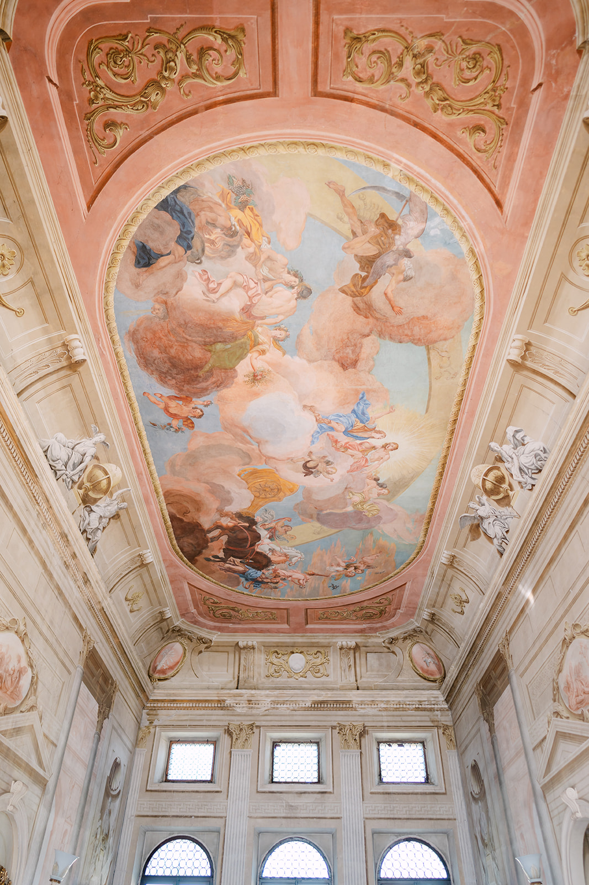
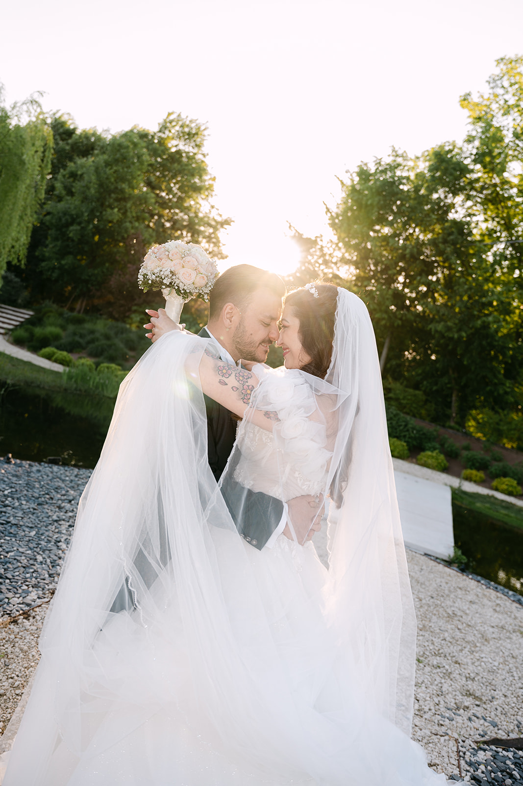
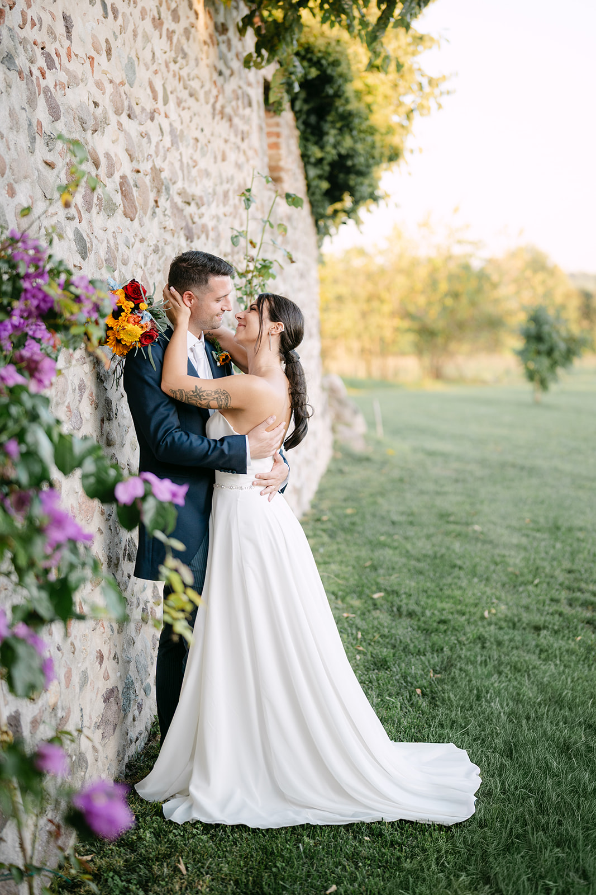
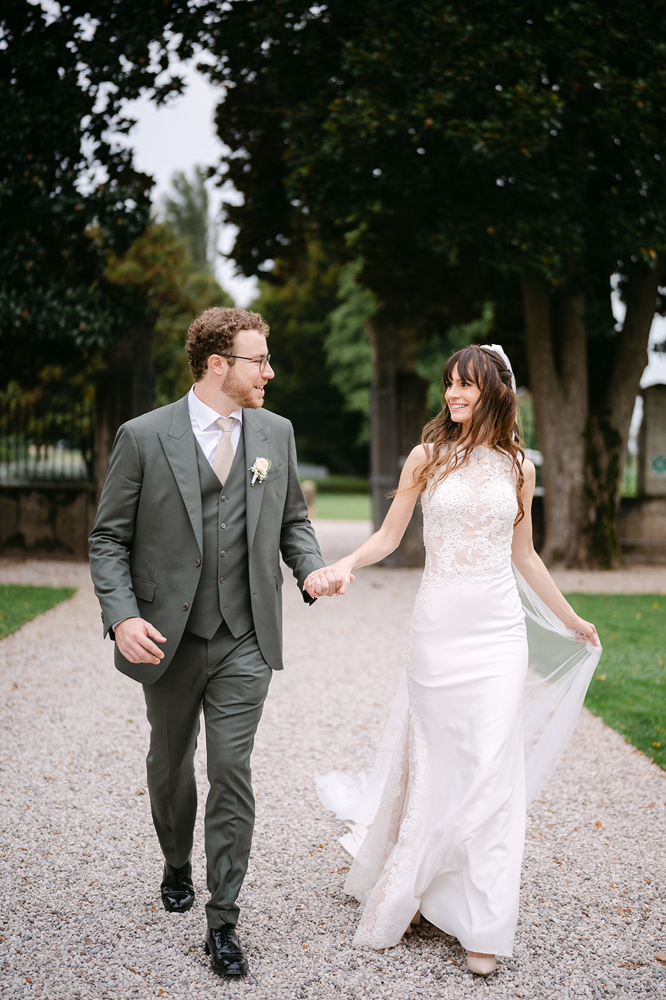

<!--
Draft to be reviewed by the owner (see the Italian file for the full notes).
- PHOTOS: placeholders from the portfolio, not taken on Lake Como.
- VENUES: general information from public sources (November 2026), to be checked with each venue before launch.
-->

Lake Como is narrow and deep, framed by mountains that drop steeply into the water. Historic villas sit right at the water’s edge, with terraced gardens, private boathouses and staircases that end in the lake.

It is one of the most loved places in the world to get married, and it is easy to see why: here the landscape already tells half the story.

### The lake and its villages

The lake is shaped like an upside-down Y, with three branches meeting in front of Bellagio. The **central lake**, between Bellagio, Varenna, Tremezzo and Menaggio, is the heart of weddings: colourful villages, villas and ferries linking one shore to the other in minutes.

The **Como branch**, to the south, is the closest to Milan, with large villas and parks that suit weddings with many guests.

### Light and seasons

May, June and September are the best months: gardens in bloom, pleasant temperatures and long days. In summer the lake is beautiful but busy, and the ferries are full.

Here light needs more planning than elsewhere. The mountains are high and close: in many places the sun disappears early, and one shore can be in shade while the other is still in the light. The western shore, around Tremezzo, gets the morning sun; the eastern shore, towards Varenna, keeps it until evening. Knowing where the sun will be at portrait time changes everything.

> On Lake Como the sun plays hide and seek with the mountains: the portrait timeline is built around it.

### Venues to know

**Villa del Balbianello, Lenno.** A villa on a wooded headland reaching into the lake, with terraced gardens. You arrive by boat, or on foot along a path.

**Villa Carlotta, Tremezzo.** An 18th-century villa with a large botanical garden and a museum, looking out over the Tremezzina and Bellagio.

**Villa Monastero, Varenna.** A former monastery turned villa, with a botanical garden stretching for hundreds of metres along the shore.

**Villa Erba, Cernobbio.** A 19th-century villa with a wide park on the lake, also suited to weddings with many guests.

**The villages.** Bellagio, Varenna and Tremezzo, with their alleys, staircases and lakefronts, are perfect for portraits, even the day after the wedding.

An important note: in Italy civil weddings are celebrated in venues authorised by the local Comune, and not every villa can host a legally valid one. Many couples choose a symbolic ceremony at the villa: always check with the venue or with your wedding planner.

### Practical tips

**Everything by boat.** Water taxis and ferries are the most beautiful and often the fastest way to get around: book them early, for your guests too.

**The roads.** The lakeside roads are narrow and busy in summer; large coaches cannot get everywhere.

**Guests from abroad.** Milan and Bergamo airports are about an hour away; trains from Milan also run to Como and Varenna.

**Book early.** The most sought-after villas have calendars full well in advance, especially in June and September.

### How we tell it

We are based in Verona, a couple of hours from Lake Como. Photography and film together, with a single vision: to tell your day without forcing it, leaving room for the lake, its light and its villas.

We work closely with your wedding planner and your venue to build a timeline that follows the light and leaves you free to simply live it.
