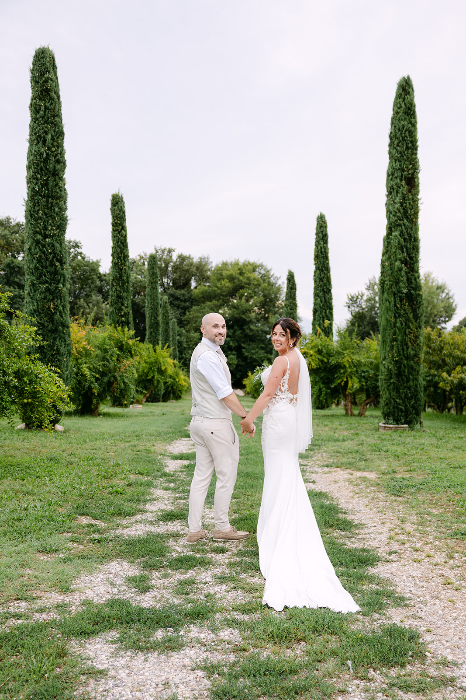
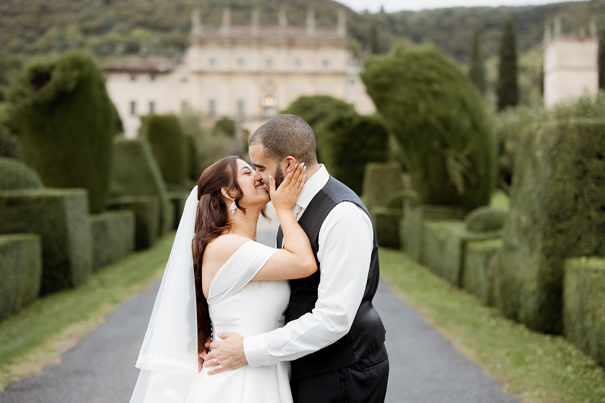
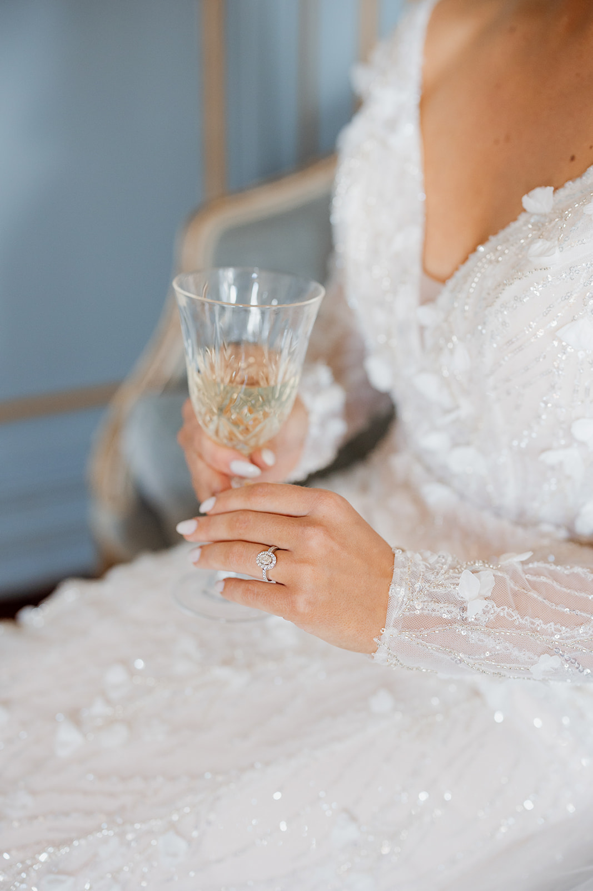
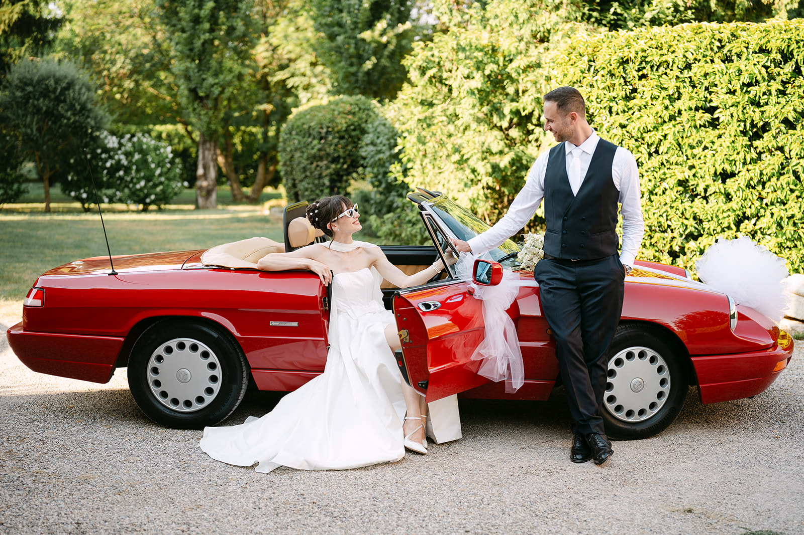

<!--
Draft to be reviewed by the owner (see the Italian file for the full notes).
- PHOTOS: placeholders from the portfolio, not taken on Lake Garda.
- VENUES: general information from public sources (November 2026), to be checked with each venue before launch.
-->

Lake Garda has something few places have: water that changes colour from one hour to the next, mountains to the north, olive and lemon trees a few steps from the shore. It is the largest lake in Italy, and every shore has its own character.

When you get married here, the question is not only “which venue” but “which Garda”. This guide starts from there: how the light, the villages and the distances change from one shore to another.

### Three shores, three characters

The **Verona shore**, to the east, is Bardolino, Garda, Torri del Benaco and Malcesine, with Monte Baldo behind. It faces west, which is why it gets sunsets over the water.

The **Brescia shore**, to the west, is Salò, Gardone Riviera and Gargnano: historic villas, gardens and lemon houses, a quieter kind of elegance. Here the sun sets early behind the mountains, and the evening light turns soft before anywhere else.

The **southern lake**, between Sirmione, Desenzano and Peschiera, is more open and bright, with a wide horizon and villages on the water. It is also the easiest area for your guests to reach.

### Light and seasons

The best months for a Lake Garda wedding are May, June and September: long days, pleasant temperatures and clean light. July and August are beautiful but hot, with a busier lake and a light haze in the middle of the day.

For photos, the best moment is the last hour before sunset. On the Verona shore the sun sets over the water; on the Brescia shore it is worth planning portraits earlier, before it drops behind the mountains. Wind matters too: in the morning it blows from the north, in the afternoon it comes back from the south. Keep it in mind for an outdoor ceremony or a boat ride.

> On the lake the light changes every ten minutes: it is the light that writes the portrait timeline.

### Venues to know

**Isola del Garda.** The largest island on the lake, off San Felice del Benaco. A neo-Gothic villa in Venetian style, terraced Italian gardens and an English park. You arrive by boat, and the arrival is already part of the story.

**Villa Cortine Palace, Sirmione.** A historic villa set in a large park on the Sirmione peninsula, with the lake always in the background and the old town a short walk away.

**Villa Bettoni, Gargnano.** An 18th-century residence facing the water in Bogliaco, with a theatrical Italian garden behind it.

**Punta San Vigilio.** A small headland between Garda and Torri del Benaco, with its bay, tiny harbour and cypresses: one of the most photographed views on the lake, perfect for an intimate wedding or for portraits.

**The villages.** Malcesine and its castle, Torri del Benaco, Bardolino, Salò: alleys, little harbours and lakefront promenades for portraits, or for a walk with your guests before the party.

Availability, capacity and ceremony rules change from venue to venue: always check directly with the venue or with your wedding planner.

### Practical tips

**Getting around.** In summer the road around the lake is busy, especially at weekends. Allow plenty of time between ceremony and reception, and consider a shuttle or a boat for your guests.

**Guests from abroad.** Verona airport is less than half an hour from the southern lake; Brescia, Bergamo and Milan are also within easy reach by train or car.

**Plan B.** Summer storms and wind arrive quickly: ask the venue which covered space is available, and choose an alternative you genuinely like, not just a fallback.

**The timeline.** Leave room for portraits in the last hour of light, even just twenty minutes away from the guests. It is worth it.

### How we tell it

We are based in Verona, less than an hour from every shore of the lake. Photography and film together, with a single vision: to observe the day without forcing it, and let the lake play its part, with its light, its wind and its colours.

We work closely with your wedding planner and your venue to build a timeline that follows the light and leaves you free to simply live it.
