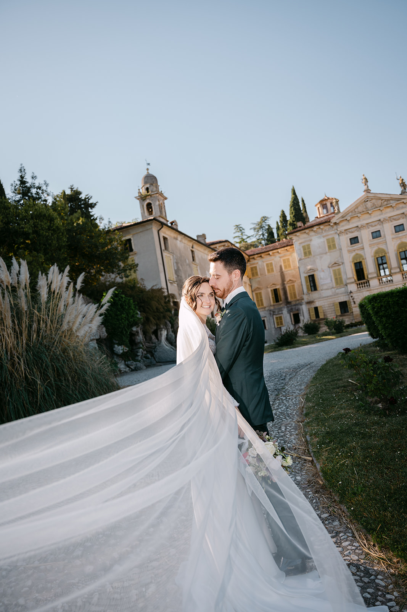
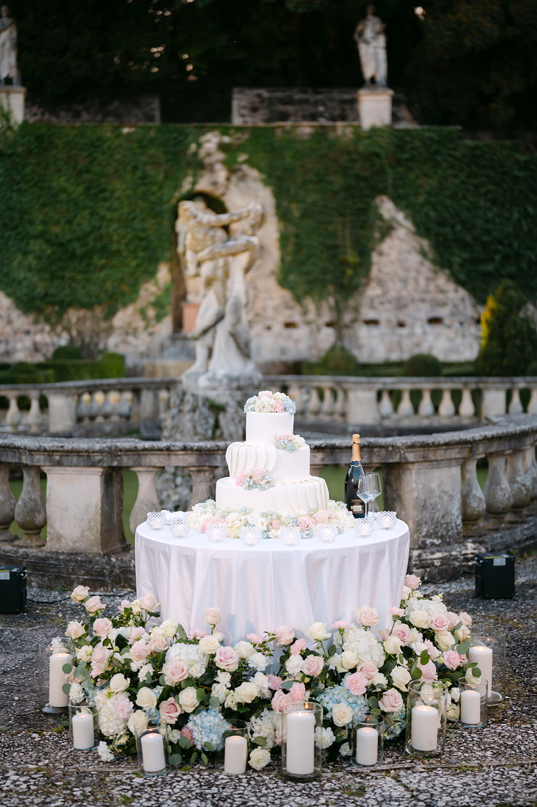
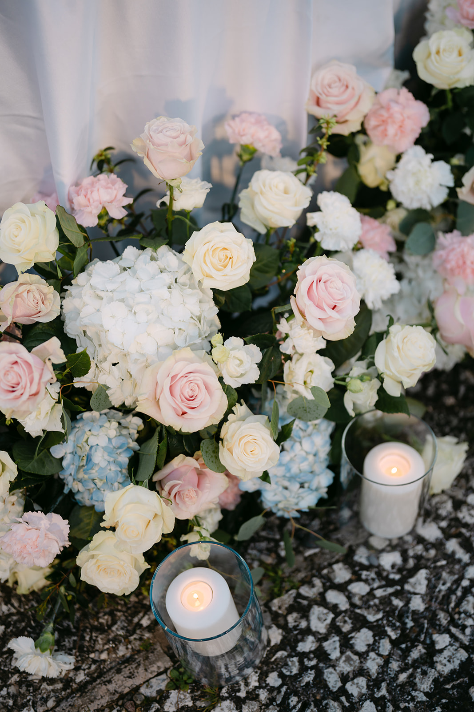
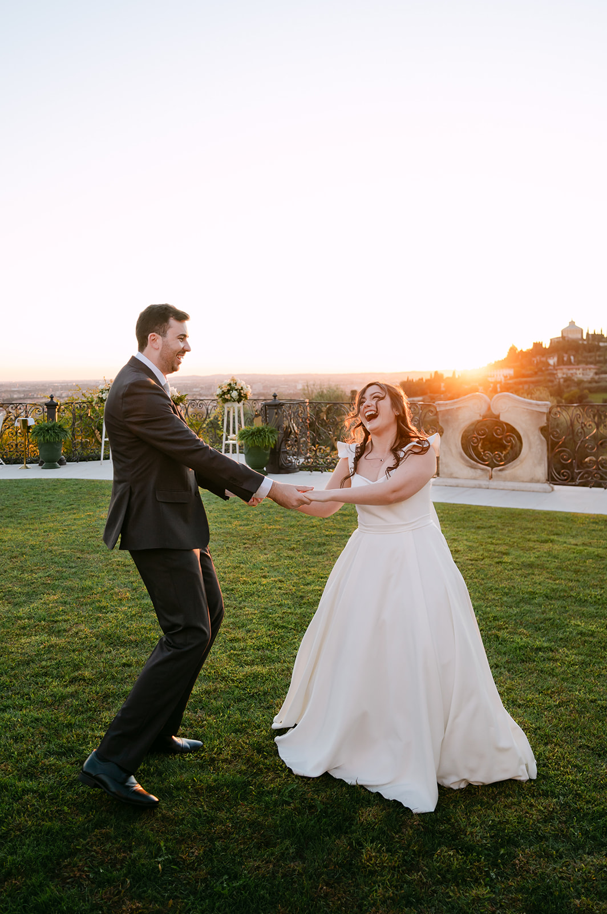

<!--
Draft to be reviewed by the owner (see the Italian file for the full notes).
- PHOTOS: placeholders from the portfolio, not taken in Tuscany.
- VENUES: general information from public sources (November 2026), to be checked with each venue before launch.
-->

Tuscany is the dream of so many couples marrying in Italy, and it is easy to see why. Hills rolling as far as the eye can see, rows of cypresses, stone villages and castles among the vineyards, and just a few kilometres away Florence, with its art and its palaces.

We experienced it up close at Castello di Mugnana, in Chianti, where we told the story of Johanna and Côme’s wedding ([watch their film](/#films)): a day of glances, smiles and real emotion, among ancient walls and the hills around them.

### Florence or the countryside?

This is the first choice to make. **Florence** is for couples who dream of art and the city: the Comune also celebrates civil weddings in Palazzo Vecchio, and the centre offers unique portraits, from Ponte Vecchio at sunrise to Piazzale Michelangelo at sunset. Above the city, the hills of **Fiesole** offer villas and castles with Florence at their feet.

**Chianti**, between Florence and Siena, is for those who want the countryside: castles, villages and wineries among the vines, slow days and parties that last into the night. Many couples choose both: the ceremony in the city, the party in the hills.

### Light and seasons

May, June, September and October are the most beautiful months. In spring the hills are green and full of flowers; in autumn the harvest arrives and the vineyards turn yellow and red. July and August are very hot: better to move the ceremony towards the evening.

Late-afternoon light in Tuscany has something special: it slides across the hills, stretches the shadows of the cypresses and turns everything golden. It is the hour worth keeping free for portraits.

> On the Tuscan hills the evening light stretches the shadows of the cypresses: it is the moment when everything becomes a story.

### Venues to know

**Castello di Mugnana, Chianti.** A medieval castle in the Chianti hills, near Greve, with gardens, vineyards and views over the countryside. This is where we told the story of Johanna and Côme’s wedding.

**Castello di Vincigliata, Fiesole.** A medieval castle on a hill east of Fiesole, with Florence in the background and a fairytale atmosphere.

**Villa Maiano, Fiesole.** A villa between Fiesole and Florence, set in a large estate of olive groves and woods.

**Castello del Trebbio, Chianti Rufina.** An ancient castle in the Chianti Rufina wine area, surrounded by farmhouses and gardens.

**Borgo di Pietrafitta, Castellina in Chianti.** A stone hamlet turned relais, with a pool overlooking the valley.

**Borgo Castelvecchi.** Halfway between Siena and Florence, in the heart of Chianti, a village owned for centuries by the same noble family.

Availability, capacity and ceremony rules change from venue to venue: always check directly with the venue or with your wedding planner.

### Practical tips

**The roads.** In the hills roads are narrow and often unpaved: a shuttle for your guests is almost always the best choice, especially for the ride home.

**Staying on site.** Many villages and castles have rooms for guests: a wedding over several days, with a welcome dinner and a brunch, is one of the joys of Tuscany.

**Guests from abroad.** The nearest airports are Florence and Pisa; Bologna is also an hour by train from Florence.

**Summer.** In the heat of July and August, plan a late-afternoon ceremony and plenty of shade for your guests.

### How we tell it

We are based in Verona, an hour and a half by train from Florence. Photography and film together, with a single vision: to tell your day without forcing it. To get a feel for how we see a wedding, watch our [wedding films](/#films), browse the [portfolio](/#portfolio) and read the diaries of our [Real Weddings](/#real-weddings).

We work closely with your wedding planner and your venue to build a timeline that follows the light and leaves you free to simply live it.
