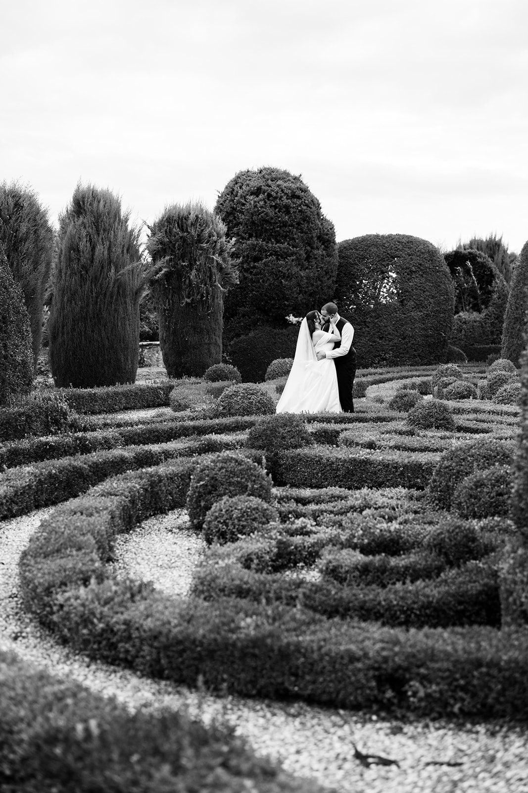
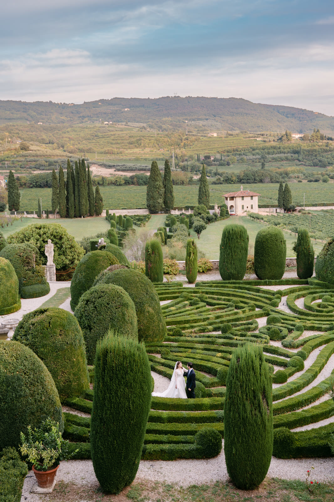
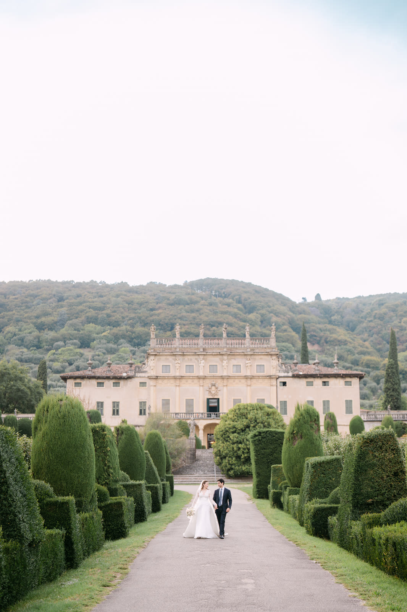
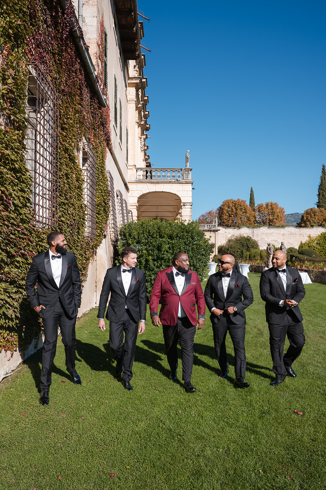
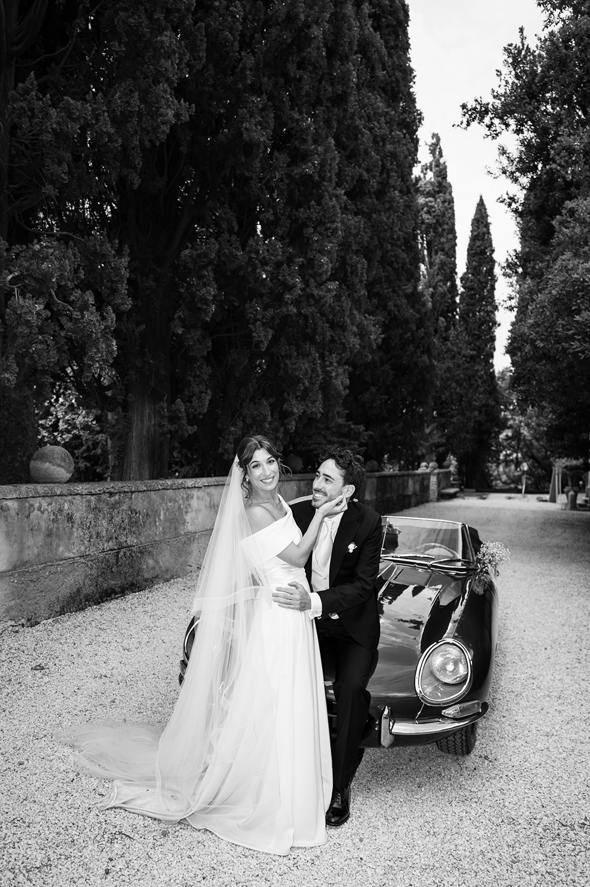

<!--
Draft to be reviewed by the owner (see the Italian file for the full notes).
- PHOTOS: placeholders from the portfolio, not taken in Valpolicella.
- VENUES: general information from public sources (November 2026), to be checked with each venue before launch.
-->

Valpolicella begins where Verona ends. Twenty minutes are enough to go from the city to the hills: terraced vineyards, dry-stone walls the locals call *marogne*, cherry trees, Romanesque churches and Venetian villas looking out over the plain.

This is the land of Amarone, and you can feel it: a wedding here means a celebration that tastes of wine, stone and countryside, with the elegance of historic villas and the city close by.

## Why Valpolicella

If you are looking for a historic villa without giving up convenience, it is hard to do better. Verona, the airport and Lake Garda are close, venues are often surrounded by vineyards, and many villas have a wine cellar where guests can gather for an aperitivo or a tasting.

It is also a compact area: Negrar, Fumane, Marano, Sant’Ambrogio and San Pietro in Cariano are only a few kilometres apart, so the day flows without long transfers.

## Light and seasons

In spring the hills are green and the cherry trees in bloom; in June the days are long and the evening light slides golden across the vines. September and October are harvest months: colours warm up, the air is cool and the vineyards are at their most beautiful.

For portraits the best light comes in the last hour of the day, when the sun drops over the plain and lights the hills from the side. In autumn it comes early: plan the timeline ahead.

> Among the vines the sunset light comes in from the side, and everything takes on a warm colour, almost like wine.

## Venues to know

**Villa della Torre, Fumane.** A 16th-century Renaissance villa, with a peristyle courtyard and its famous mask-shaped fireplaces. Today it belongs to a historic winemaking family, and brings together art, gardens and wine.

**Villa Mosconi Bertani, Arbizzano di Negrar.** An 18th-century villa with a romantic park and a small lake, linked to one of the historic wineries of Valpolicella.

**Villa Rizzardi, Negrar.** Famous for its 18th-century garden, with hornbeam avenues, perspective views and a green theatre.

**Villa Spinosa, Negrar.** A 19th-century villa on the hill, in the small village of Jago, among gardens and vineyards.

**Villa Amistà, San Pietro in Cariano.** A 16th-century Venetian villa, now a hotel, where historic architecture meets contemporary art.

**The Pieve di San Giorgio di Valpolicella.** A Romanesque parish church at the top of the hill, in the village of San Giorgio: for a religious ceremony with a view over the whole valley.

A little further east, in Valpantena, is **Villa Arvedi**, where we told the weddings of Imani and John ([watch their film](/#films)) and of Alina and Omrane ([read their diary](/real-weddings/alina-omrane/)): another way to experience the hills around Verona, among cypresses, vineyards and an Italian garden of boxwood hedges shaped like a maze.

Availability, capacity and ceremony rules change from venue to venue: always check directly with the venue or with your wedding planner.

## Practical tips

**Hill roads.** They are narrow and sometimes unlit: a shuttle for your guests between ceremony, reception and hotel is almost always the best choice.

**Guests from abroad.** Verona airport is about half an hour away; many guests can stay in the city or in the relais around the area.

**The wine cellar.** If your venue has one, use it: an aperitivo among the barrels or a tasting for your guests from abroad are moments that stay with you, in the photos too.

**Autumn evenings.** In October the temperature drops quickly after sunset: plan a covered or heated space for dinner.

## How we tell it

Valpolicella is home for us: we are based in Verona, just minutes from its hills. Photography and film together, with a single vision: to tell your day without forcing it, among the stone of the villas, the green of the vineyards and the evening light. To get a feel for how we see a wedding, watch our [wedding films](/#films), browse the [portfolio](/#portfolio) and read the diaries of our [Real Weddings](/#real-weddings).

We work closely with your wedding planner and your venue to build a timeline that follows the light and leaves you free to simply live it.
