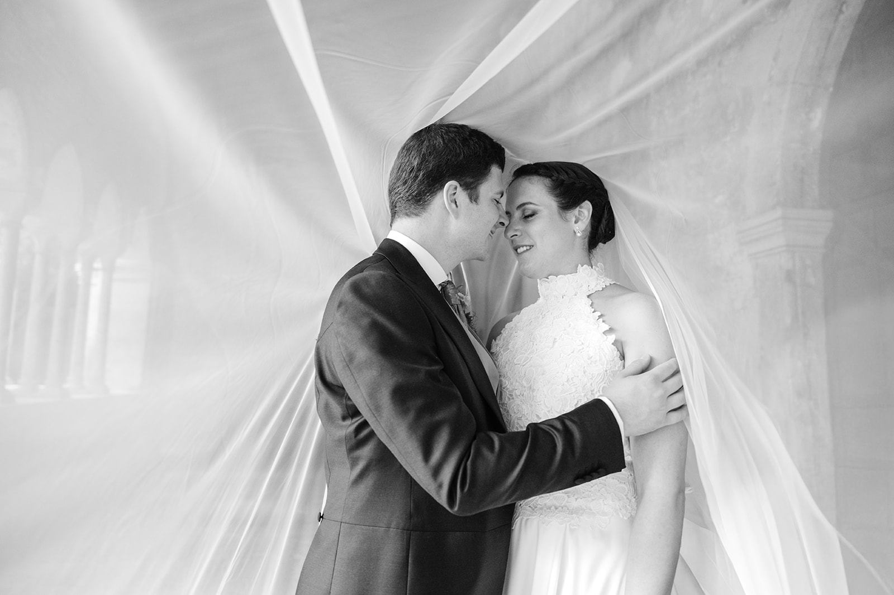
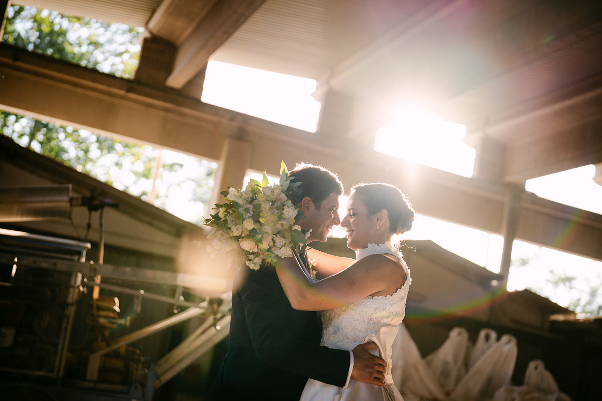
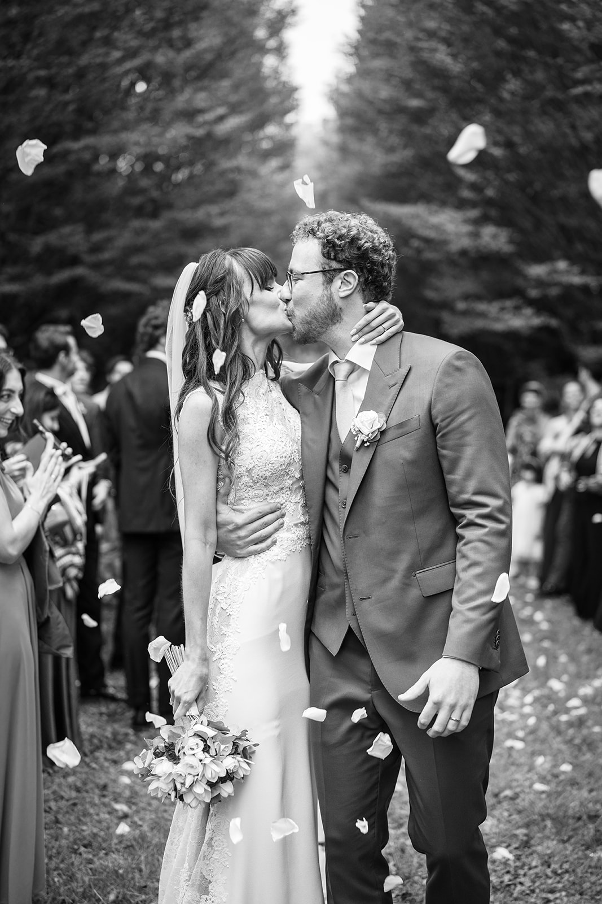
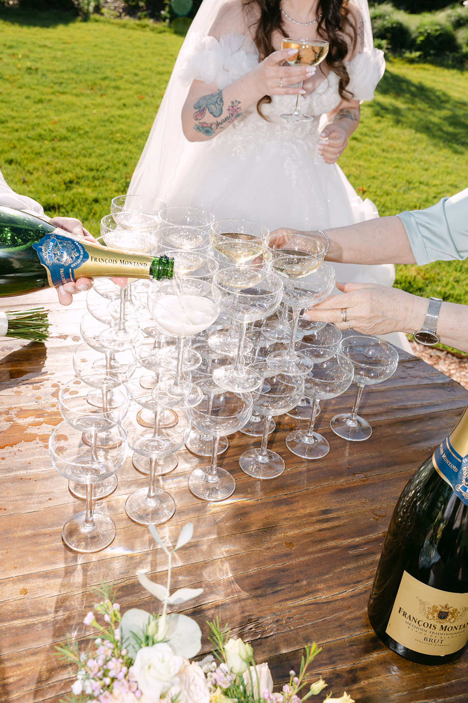

<!--
Draft to be reviewed by the owner (see the Italian file for the full notes).
- PHOTOS: placeholders from the portfolio, not taken in Venice.
- CIVIL CEREMONIES: venues, fees and paperwork to be checked with the Comune di Venezia before launch.
-->

Venice is like nowhere else. There are no cars, only water, bridges and narrow streets; you move by boat or on foot, and every journey is already part of the story. For a wedding it is a bold and unforgettable choice.

It is the perfect city for an intimate wedding with few guests, or for an elopement just the two of you. But with the right planning it can also host larger celebrations, in palaces on the water or on the islands of the lagoon.

## The civil ceremony

The Comune di Venezia celebrates civil weddings at **Palazzo Cavalli**, a historic palace on the Grand Canal, and in a few other historic venues in the city. You arrive by boat and leave married on the canal: it is hard to imagine a more Venetian beginning.

For a symbolic ceremony the options multiply: hotel terraces and gardens on the Grand Canal, hidden cloisters, the islands of the lagoon. Venues, fees and paperwork change: always check with the Comune or with your wedding planner.

## An intimate wedding, or an elopement

Venice is at its best when you take it slowly. A walk at sunrise through an almost empty Piazza San Marco, a gondola ride through the canals, the light on the façades of the Grand Canal.

Beyond the centre, the lagoon has another soul: **Burano** with its colourful houses, quiet green **Torcello** with its ancient basilica, and the view of San Marco from the island of **San Giorgio Maggiore**. For an elopement these places are perfect: a few steps, no crowds, plenty of light.

> In Venice every journey is a story: you set off by boat and arrive married.

## Light and seasons

Spring and September are the best months: soft light, pleasant temperatures and a city less crowded than in high summer. Winter has its own charm, with fog over the lagoon, but in autumn and winter high water can arrive.

For photos the most precious moment is sunrise: the city is still empty, the water is still and the light settles slowly on the façades. In the evening, sunset paints the lagoon pink and gold.

## Practical tips

**Everything by boat.** Water taxis, private boats and porters for luggage need to be booked in advance; in a Venetian wedding, logistics are half the celebration.

**Shoes.** Bridges, steps and stone paving: comfortable shoes for the couple and the guests, at least for getting around.

**City rules.** On some days visitors arriving just for the day pay an access fee, and there are specific rules for photos and filming with drones or bulky equipment: look into them early.

**Guests from abroad.** Marco Polo airport is connected to the city by water too; from Verona it is just over an hour by train.

## How we tell it

We are based in Verona, just over an hour by train from Venice. Photography and film together, with a single vision: to tell your day without forcing it, following the slow rhythm of the city and its light. To get a feel for how we see a wedding, watch our [wedding films](/#films), browse the [portfolio](/#portfolio) and read the diaries of our [Real Weddings](/#real-weddings).

We work closely with your wedding planner to build a day where every boat, every bridge and every portrait arrives at the right moment.
