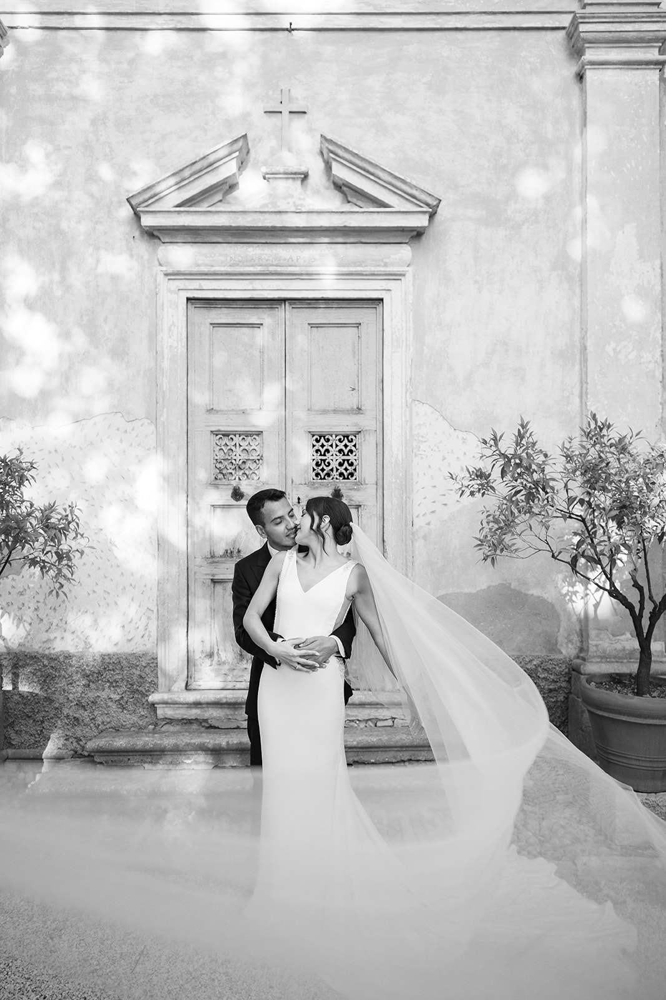
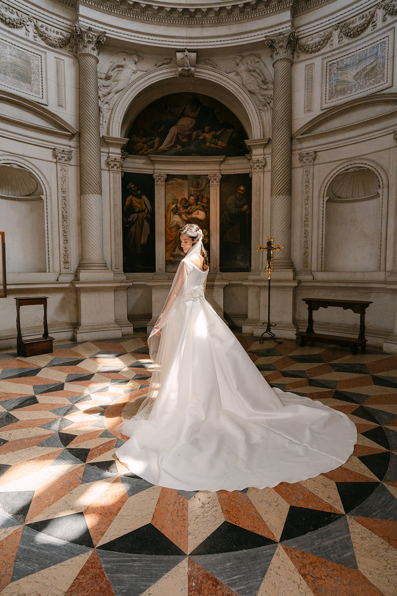
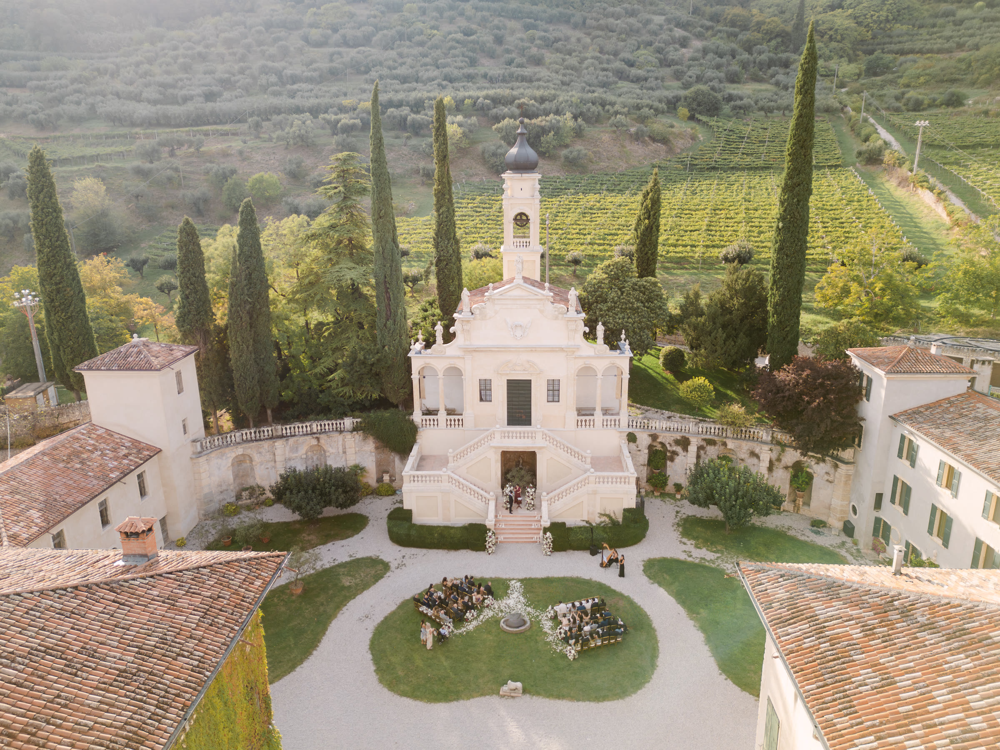
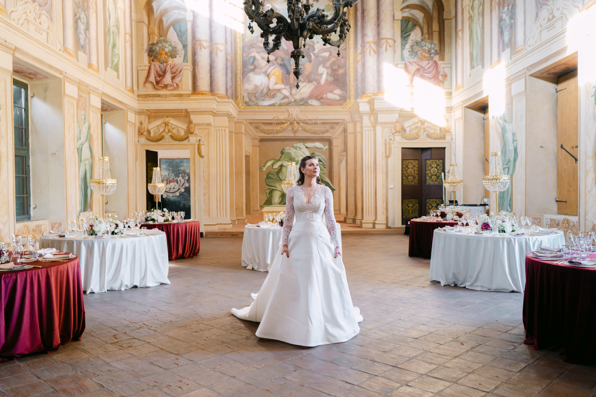
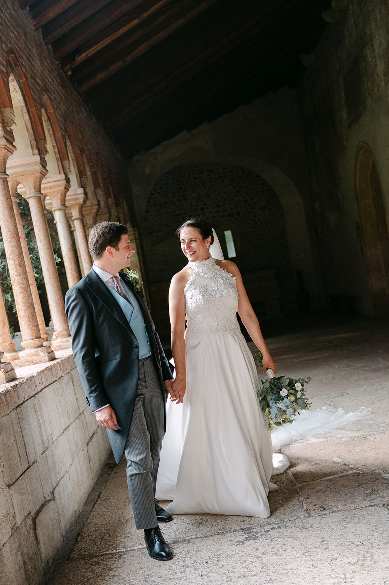
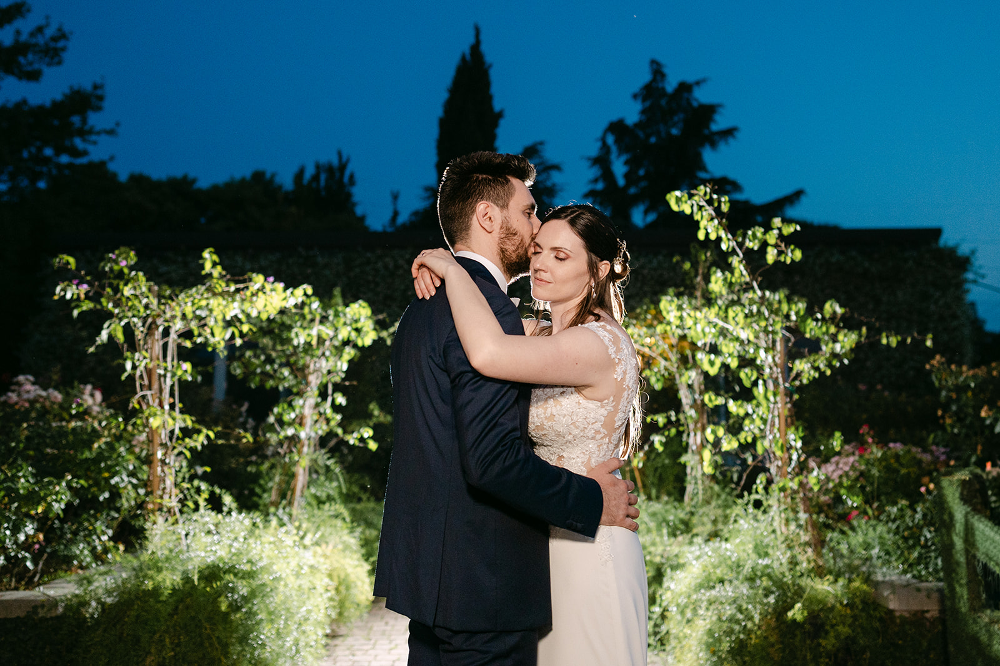

<!--
Draft to be reviewed by the owner (see the Italian file for the full notes).
- PHOTOS: placeholders from the portfolio.
- CIVIL CEREMONIES: rooms, fees and requirements change; check with the Comune di Verona before launch.
-->

Verona is home for us. To the world it is the city of Romeo and Juliet, and when you get married here that story is a thread you feel everywhere. But Verona is also the Arena, the Adige river curving through it, palaces of pink stone and the hills that embrace it to the north.

It is a city to explore on foot, where a few steps take you from a medieval square to a Roman bridge. For a wedding that means one thing: every corner can become a portrait.

## A city to walk through

The historic centre is a UNESCO World Heritage Site, and it is compact: Piazza delle Erbe with its frescoed palaces, Piazza dei Signori, the Arena, Ponte Pietra over the Adige. Across the river, the steps up to Castel San Pietro lead to the viewpoint over the whole city, one of the most beautiful places for sunset portraits.

## Civil ceremonies in Juliet’s places

The Comune di Verona celebrates civil weddings in some of the city’s historic places: Juliet’s House, the frescoed hall of the Fresco Museum next to Juliet’s Tomb, the Tapestry Hall of Palazzo Barbieri, steps from the Arena, and the Notaries’ Chapel.

These are intimate ceremonies for a small number of guests, often followed by a reception in a villa in the hills. Available rooms, fees and paperwork change over time and depending on your nationality: always check with the Comune or with your wedding planner.

> In Verona you only have to turn a corner to find new light: among the stones of the old town, every alley can become a portrait.

## Light and seasons

Spring and September are the most beautiful times: mild air, soft light and a lively but not crowded city. Summer is hot and, during the Arena opera season, the centre is full of visitors.

For portraits in the old town, the secret is sunrise: empty squares, stone glowing pink, the river still. In the evening, head up to Castel San Pietro and watch the sun go down over the rooftops.

## Venues around the city

**Relais Fra Lorenzo.** A villa on the hill above the historic centre, with a panoramic terrace over the city. It is named after the friar who, in the story, secretly married Romeo and Juliet. This is where we told the story of Daniel and Josiane’s wedding: [watch their film](/#films).

**Villa Arvedi.** A Baroque villa in the hills of Valpantena, a few minutes from the city, among cypresses and Italian gardens, with the frescoed Hall of the Titans for the most spectacular dinners. This is where we told the weddings of Imani and John and of Jasmine and Daniel, which you can find among our [wedding films](/#films), and that of Alina and Omrane: [read their diary](/real-weddings/alina-omrane/).

If you are looking for vineyards and Venetian villas, [Valpolicella](/guides/valpolicella/) is twenty minutes away; for water and sunsets, [Lake Garda](/guides/lake-garda/) is half an hour.

## Practical tips

**The ZTL.** The old town is a limited traffic zone: vintage cars, shuttles and suppliers need permits, to be requested well in advance.

**Hotels.** During the opera season rooms in the centre go fast: book early for your guests.

**Guests from abroad.** Verona airport is a quarter of an hour from the centre, and Porta Nuova station connects the city to Milan, Venice and Bologna.

**From ceremony to party.** If you marry in the old town and celebrate in the hills, allow plenty of time for the transfer and for portraits along the way.

## How we tell it

We know Verona the way you know home: the hours when the squares empty out, the corners where the light arrives first, the roads that save time between ceremony and party. Photography and film together, with a single vision: to tell your day without forcing it. To get a feel for how we see a wedding, watch our [wedding films](/#films), browse the [portfolio](/#portfolio) and read the diaries of our [Real Weddings](/#real-weddings).

We work closely with your wedding planner and your venue to build a timeline that follows the light and leaves you free to simply live it.
