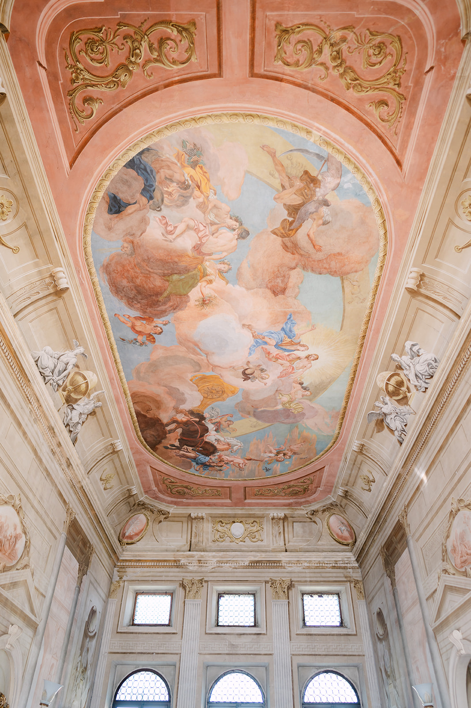
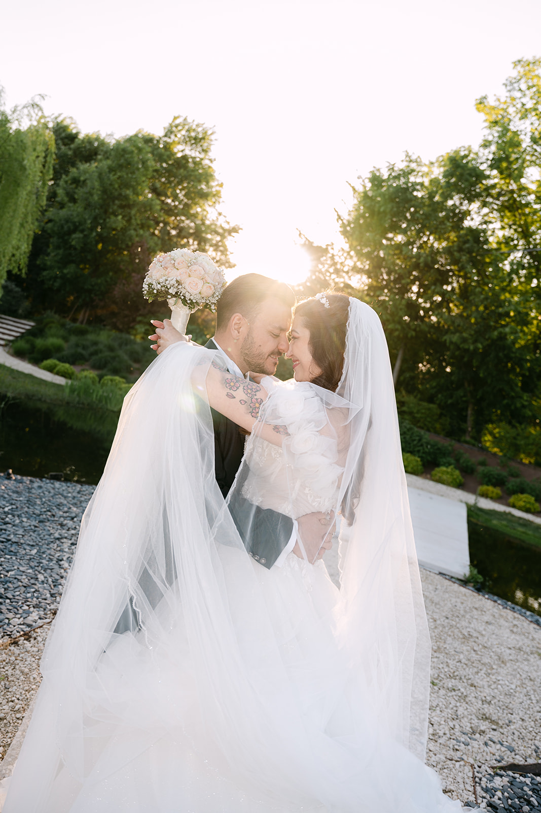
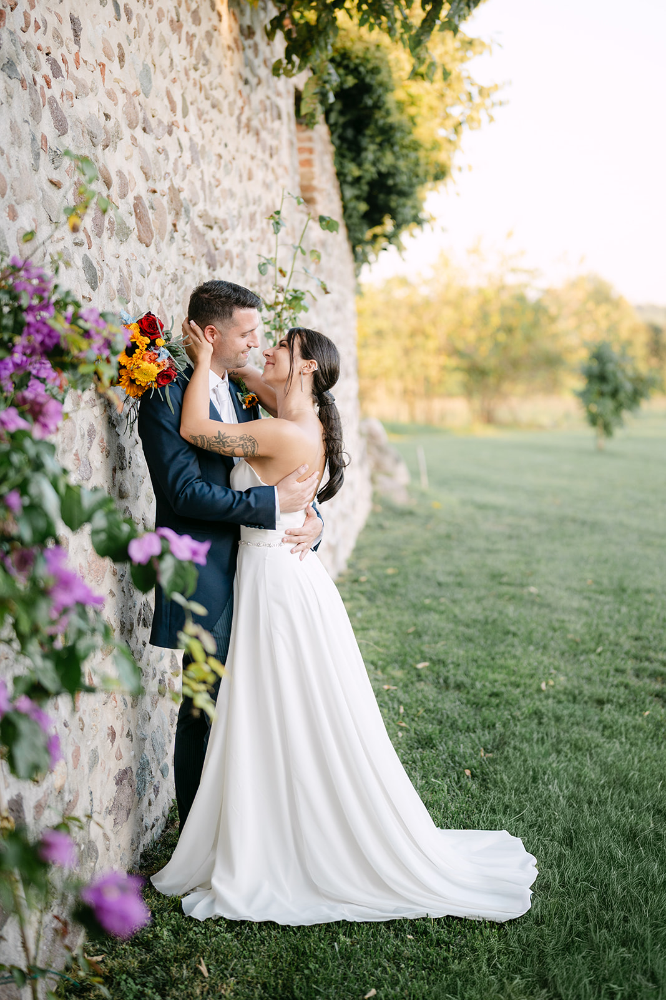
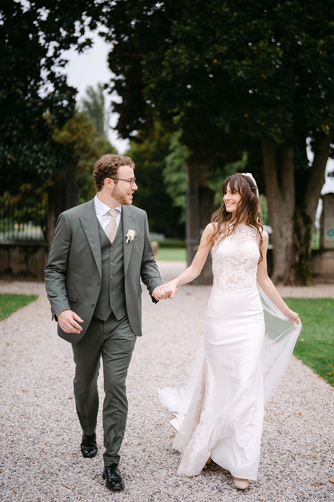

<!--
Bozza da rivedere con il proprietario.
- FOTO: segnaposto dal portfolio, non scattate sul Lago di Como.
- LOCATION: informazioni generali da fonti pubbliche (novembre 2026), da verificare con ogni location prima del lancio.
- Non abbiamo lavorato sul Lago di Como: nessuna location va presentata come nostra.
-->

Il Lago di Como è stretto e profondo, chiuso tra montagne che scendono ripide fino all’acqua. Le ville storiche si affacciano a filo del lago, con giardini a terrazze, darsene private e scalinate che finiscono direttamente in acqua.

È uno dei luoghi più amati al mondo per sposarsi, ed è facile capire perché: qui il paesaggio fa già metà del racconto.

### Il lago e i suoi paesi

Il lago ha la forma di una Y rovesciata, con tre rami che si incontrano davanti a Bellagio. Il **centro lago**, tra Bellagio, Varenna, Tremezzo e Menaggio, è il cuore dei matrimoni: paesi colorati, ville e traghetti che collegano una sponda all’altra in pochi minuti.

Il **ramo di Como**, verso sud, è quello più vicino a Milano, con ville grandi e parchi adatti anche a matrimoni con molti ospiti.

### La luce e le stagioni

Maggio, giugno e settembre sono i mesi migliori: giardini in fiore, temperature piacevoli e giornate lunghe. In estate il lago è bellissimo ma affollato, e i traghetti sono pieni.

Qui la luce va studiata più che altrove. Le montagne sono alte e vicine: in molti punti il sole sparisce presto, e una sponda può essere in ombra mentre l’altra è ancora illuminata. La sponda occidentale, quella di Tremezzo, ha il sole del mattino; quella orientale, verso Varenna, lo tiene fino a sera. Sapere dove sarà il sole all’ora dei ritratti cambia tutto.

> Sul Lago di Como il sole gioca a nascondino con le montagne: la timeline dei ritratti si costruisce intorno a lui.

### Location da conoscere

**Villa del Balbianello, Lenno.** Una villa su un promontorio boscoso che si allunga nel lago, con giardini a terrazze. Si arriva in barca, oppure a piedi lungo un sentiero.

**Villa Carlotta, Tremezzo.** Una villa settecentesca con un grande giardino botanico e un museo, affacciata sulla Tremezzina e su Bellagio.

**Villa Monastero, Varenna.** Un antico monastero diventato villa, con un giardino botanico che si allunga per centinaia di metri lungo la riva.

**Villa Erba, Cernobbio.** Una villa ottocentesca con un parco ampio sul lago, adatta anche a matrimoni con molti ospiti.

**I paesi.** Bellagio, Varenna e Tremezzo, con i loro vicoli, le scalinate e i lungolago, sono perfetti per i ritratti, anche il giorno dopo il matrimonio.

Una nota importante: in Italia il matrimonio civile si celebra nelle sedi autorizzate dal Comune, e non tutte le ville possono ospitarne uno valido. Molte coppie scelgono una cerimonia simbolica in villa: verificate sempre con la location o con il vostro wedding planner.

### Consigli pratici

**Tutto in barca.** Taxi boat e traghetti sono il modo più bello e spesso più veloce per spostarsi: prenotateli per tempo, anche per gli ospiti.

**Le strade.** Le strade che costeggiano il lago sono strette e trafficate in estate; i pullman grandi non passano ovunque.

**Gli ospiti da lontano.** Gli aeroporti di Milano e Bergamo sono a circa un’ora; da Milano partono anche i treni per Como e Varenna.

**Prenotare presto.** Le ville più richieste hanno calendari pieni con largo anticipo, soprattutto a giugno e settembre.

### Come lo raccontiamo noi

Siamo a Verona, a un paio d’ore dal Lago di Como. Fotografia e cinema insieme, con un’unica visione: raccontare la vostra giornata senza forzarla, lasciando spazio al lago, alla sua luce e alle sue ville. Per farvi un’idea del nostro sguardo, guardate i nostri [wedding film](/it/#films), sfogliate il [portfolio](/it/#portfolio) e leggete i diari dei nostri [Real Weddings](/it/#real-weddings).

Lavoriamo in contatto diretto con il vostro wedding planner e con la location, per costruire una timeline che segua la luce e lasci a voi solo il piacere di viverla.
