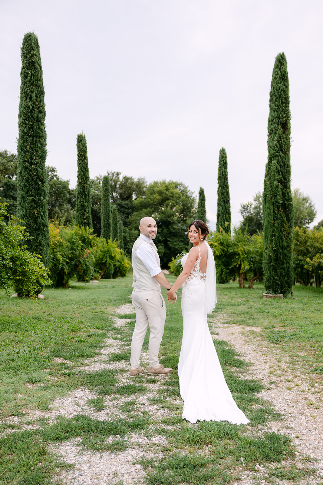
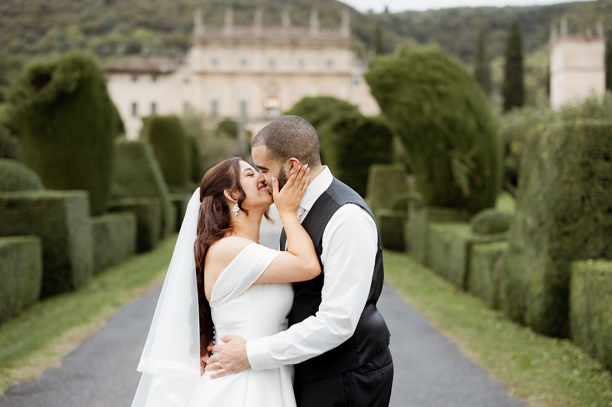
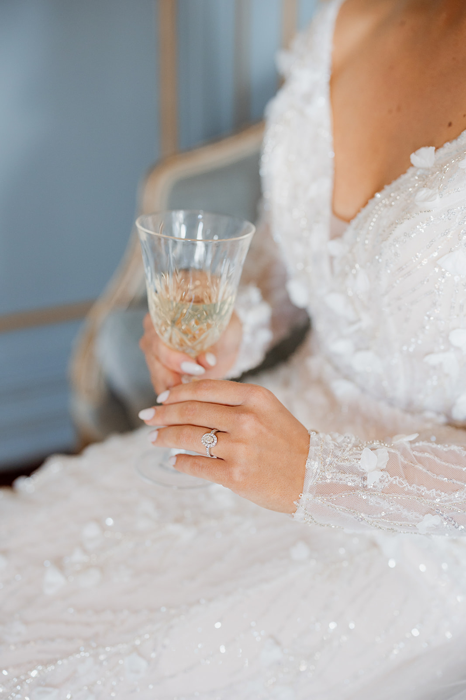
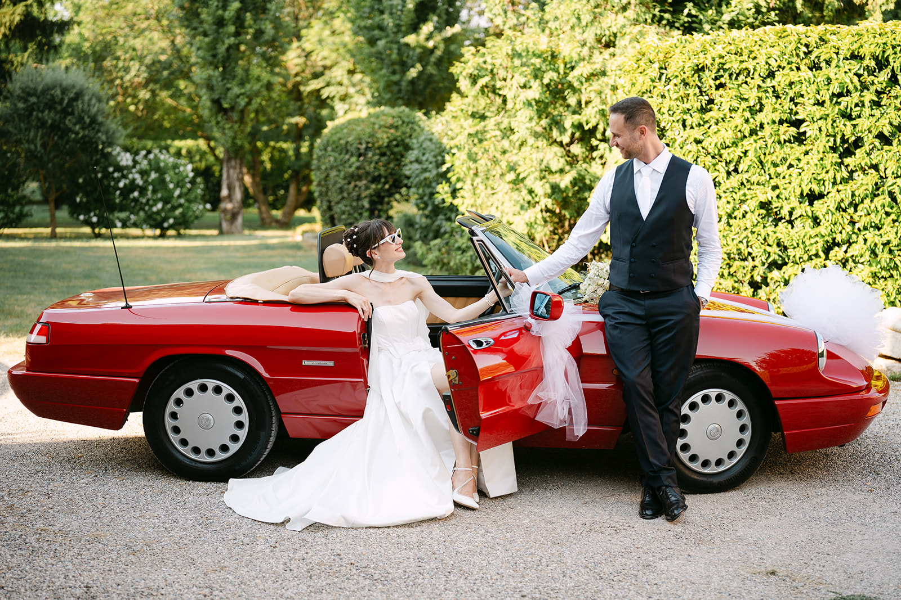

<!--
Bozza da rivedere con il proprietario.
- FOTO: segnaposto dal portfolio, non scattate sul Garda. Sostituirle con foto vere della zona appena disponibili, e non scrivere nelle didascalie dove sono state fatte se non è vero.
- LOCATION: informazioni generali, raccolte da fonti pubbliche (siti delle location e blog di settore, novembre 2026). Prima del lancio verificare con ogni location che ospiti ancora matrimoni.
- Non scrivere mai "abbiamo lavorato qui" per location dove non si è lavorato.
-->

Il Lago di Garda ha qualcosa che pochi luoghi hanno: l’acqua che cambia colore da un’ora all’altra, le montagne a nord, gli ulivi e i limoni a pochi passi dalla riva. È il lago più grande d’Italia, e ogni sponda ha un carattere diverso.

Per chi si sposa qui la domanda non è solo “quale location”, ma “quale Garda”. Questa guida nasce da lì: da come cambiano la luce, i borghi e le distanze da una sponda all’altra.

### Tre sponde, tre caratteri

La **sponda veronese**, a est, è quella di Bardolino, Garda, Torri del Benaco e Malcesine, con il Monte Baldo alle spalle. Guarda verso ovest, e per questo regala i tramonti sull’acqua.

La **sponda bresciana**, a ovest, è quella di Salò, Gardone Riviera e Gargnano: ville storiche, giardini e limonaie, un’eleganza più raccolta. Qui il sole cala presto dietro le montagne, e la luce della sera diventa morbida prima che altrove.

Il **basso lago**, tra Sirmione, Desenzano e Peschiera, è più aperto e luminoso, con l’orizzonte largo e i borghi sull’acqua. È anche la zona più comoda da raggiungere per gli ospiti.

### La luce e le stagioni

I mesi più belli per sposarsi sul Garda sono maggio, giugno e settembre: giornate lunghe, temperature piacevoli e una luce pulita. Luglio e agosto sono splendidi ma caldi, con il lago più affollato e una foschia leggera nelle ore centrali.

Per le foto il momento migliore è l’ultima ora prima del tramonto. Sulla sponda veronese il sole scende sull’acqua; su quella bresciana conviene anticipare i ritratti, prima che passi dietro le montagne. Sul lago conta anche il vento: al mattino scende da nord, nel pomeriggio risale da sud. Per una cerimonia all’aperto o un giro in barca vale la pena tenerne conto.

> Sul lago la luce cambia ogni dieci minuti: è lei a scrivere la timeline dei ritratti.

### Location da conoscere

**Isola del Garda.** La più grande isola del lago, davanti a San Felice del Benaco. Una villa neogotica in stile veneziano, giardini all’italiana a terrazze e un parco all’inglese. Si arriva in barca, e l’arrivo è già parte del racconto.

**Villa Cortine Palace, Sirmione.** Una villa storica immersa in un grande parco sulla penisola di Sirmione, con il lago sempre sullo sfondo e il borgo a pochi passi.

**Villa Bettoni, Gargnano.** Una dimora settecentesca affacciata sull’acqua, a Bogliaco, con un giardino all’italiana scenografico alle spalle.

**Punta San Vigilio.** Un piccolo promontorio tra Garda e Torri del Benaco, con la sua baia, il porticciolo e i cipressi: una delle viste più fotografate del lago, perfetta per un matrimonio intimo o per i ritratti.

**I borghi.** Malcesine con il suo castello, Torri del Benaco, Bardolino, Salò: vicoli, porticcioli e lungolago per i ritratti, o per una passeggiata con gli ospiti prima della festa.

Disponibilità, capienza e regole per la cerimonia cambiano da location a location: verificatele sempre direttamente con la struttura o con il vostro wedding planner.

### Consigli pratici

**Gli spostamenti.** In estate la strada che costeggia il lago è trafficata, soprattutto nel fine settimana. Calcolate tempi larghi tra cerimonia e ricevimento, e valutate una navetta o una barca per gli ospiti.

**Gli ospiti da lontano.** L’aeroporto di Verona è a meno di mezz’ora dal basso lago; anche Brescia, Bergamo e Milano sono a portata di treno o di auto.

**Il piano B.** Temporali estivi e vento arrivano in fretta: chiedete alla location quale spazio coperto è previsto, e scegliete un’alternativa che vi piaccia davvero, non solo un ripiego.

**La timeline.** Lasciate spazio ai ritratti nell’ultima ora di luce, anche solo venti minuti lontano dagli ospiti. Ne vale la pena.

### Come lo raccontiamo noi

Siamo a Verona, a meno di un’ora da ogni sponda del lago. Fotografia e cinema insieme, con un’unica visione: osservare la giornata senza forzarla, e lasciare che il lago faccia la sua parte, con la sua luce, il suo vento, i suoi colori. Per farvi un’idea del nostro sguardo, guardate i nostri [wedding film](/it/#films), sfogliate il [portfolio](/it/#portfolio) e leggete i diari dei nostri [Real Weddings](/it/#real-weddings).

Lavoriamo in contatto diretto con il vostro wedding planner e con la location, per costruire una timeline che segua la luce e lasci a voi solo il piacere di viverla.
