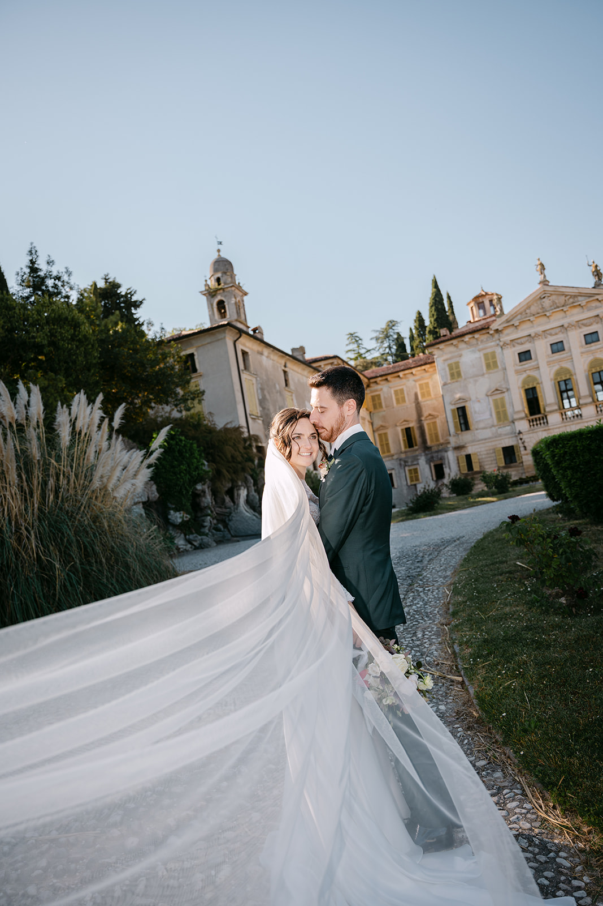
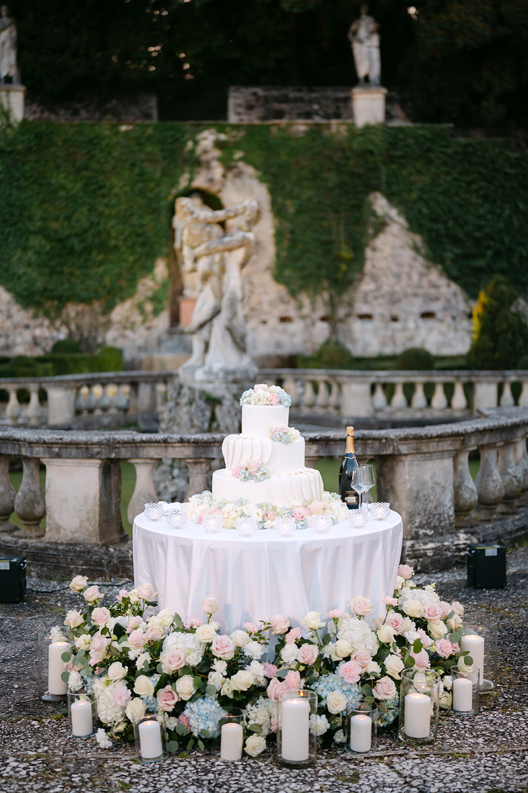
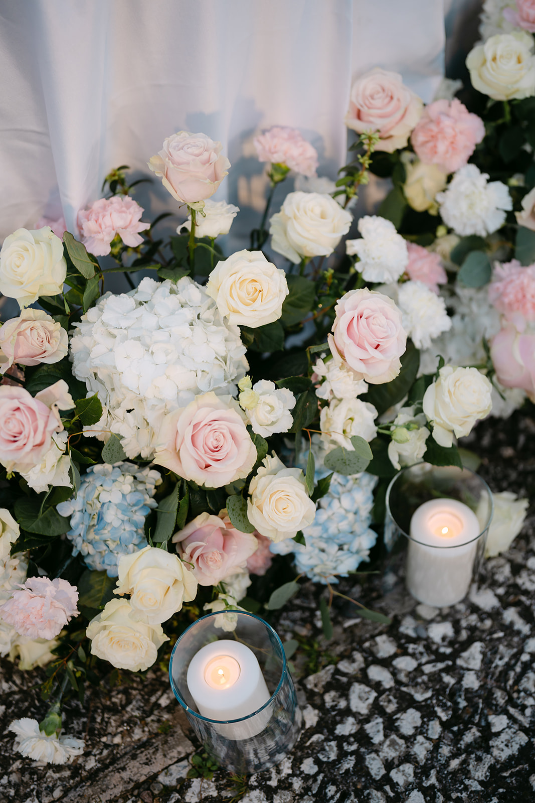
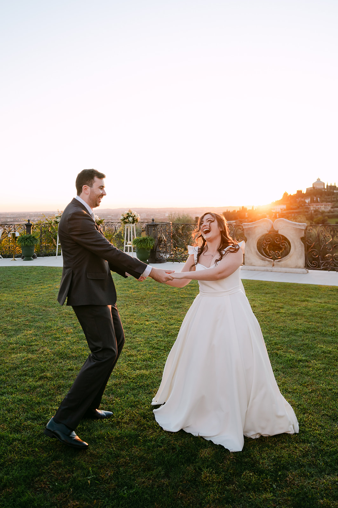

<!--
Bozza da rivedere con il proprietario.
- FOTO: segnaposto dal portfolio, non scattate in Toscana. Il proprietario non ha foto della zona oltre al film di Johanna e Côme: valutare i fotogrammi del film.
- LOCATION: informazioni generali da fonti pubbliche (novembre 2026), da verificare con ogni location prima del lancio.
- Castello di Mugnana: location dove abbiamo lavorato davvero (film di Johanna e Côme).
-->

La Toscana è il sogno di chi si sposa in Italia, e non è difficile capire perché. Colline che si susseguono a perdita d’occhio, filari di cipressi, borghi di pietra e castelli tra i vigneti, e a pochi chilometri Firenze, con la sua arte e i suoi palazzi.

L’abbiamo vissuta da vicino al Castello di Mugnana, nel Chianti, dove abbiamo raccontato il matrimonio di Johanna e Côme ([guardate il loro film](/it/#films)): una giornata di sguardi, sorrisi ed emozioni vere, tra le mura antiche e le colline intorno.

## Firenze o la campagna?

È la prima scelta da fare. **Firenze** è per chi sogna l’arte e la città: il Comune celebra i matrimoni civili anche a Palazzo Vecchio, e il centro offre ritratti unici, da Ponte Vecchio all’alba al Piazzale Michelangelo al tramonto. Sopra la città, le colline di **Fiesole** regalano ville e castelli con Firenze ai piedi.

Il **Chianti**, tra Firenze e Siena, è per chi cerca la campagna: castelli, borghi e cantine tra i vigneti, giornate lente e feste che durano fino a notte. Molte coppie scelgono le due cose insieme: la cerimonia in città, la festa in collina.

## La luce e le stagioni

Maggio, giugno, settembre e ottobre sono i mesi più belli. In primavera le colline sono verdi e piene di fiori; in autunno arriva la vendemmia, e i vigneti si colorano di giallo e rosso. Luglio e agosto sono molto caldi: meglio spostare la cerimonia verso sera.

La luce del tardo pomeriggio in Toscana ha qualcosa di speciale: scivola sulle colline, allunga le ombre dei cipressi e rende tutto dorato. È l’ora che vale la pena tenere libera per i ritratti.

> Sulle colline toscane la luce della sera allunga le ombre dei cipressi: è il momento in cui tutto diventa racconto.

## Location da conoscere

**Castello di Mugnana, Chianti.** Un castello medievale tra le colline del Chianti, vicino a Greve, con giardini, vigneti e la vista sulla campagna. Qui abbiamo raccontato il matrimonio di Johanna e Côme.

**Castello di Vincigliata, Fiesole.** Un castello medievale su un’altura a est di Fiesole, con Firenze sullo sfondo e un’atmosfera da fiaba.

**Villa Maiano, Fiesole.** Una villa tra Fiesole e Firenze, immersa in una grande tenuta di ulivi e boschi.

**Castello del Trebbio, Chianti Rufina.** Un castello antico nella zona vinicola del Chianti Rufina, con casali e giardini intorno.

**Borgo di Pietrafitta, Castellina in Chianti.** Un borgo di pietra trasformato in relais, con una piscina affacciata sulla valle.

**Borgo Castelvecchi.** A metà strada tra Siena e Firenze, nel cuore del Chianti, un borgo appartenuto per secoli alla stessa famiglia nobile.

Disponibilità, capienza e regole per la cerimonia cambiano da location a location: verificatele sempre direttamente con la struttura o con il vostro wedding planner.

## Consigli pratici

**Le strade.** In collina le strade sono strette e spesso bianche, cioè sterrate: una navetta per gli ospiti è quasi sempre la scelta migliore, anche per rientrare la sera.

**Dormire sul posto.** Molti borghi e castelli hanno camere per gli ospiti: un matrimonio di più giorni, con cena di benvenuto e brunch, è uno dei piaceri della Toscana.

**Gli ospiti da lontano.** Gli aeroporti più vicini sono Firenze e Pisa; anche Bologna è a un’ora di treno da Firenze.

**L’estate.** Con il caldo di luglio e agosto conviene una cerimonia nel tardo pomeriggio e tanta ombra per gli ospiti.

## Come lo raccontiamo noi

Siamo a Verona, a un’ora e mezza di treno da Firenze. Fotografia e cinema insieme, con un’unica visione: raccontare la vostra giornata senza forzarla. Per farvi un’idea del nostro sguardo, guardate i nostri [wedding film](/it/#films), sfogliate il [portfolio](/it/#portfolio) e leggete i diari dei nostri [Real Weddings](/it/#real-weddings).

Lavoriamo in contatto diretto con il vostro wedding planner e con la location, per costruire una timeline che segua la luce e lasci a voi solo il piacere di viverla.
