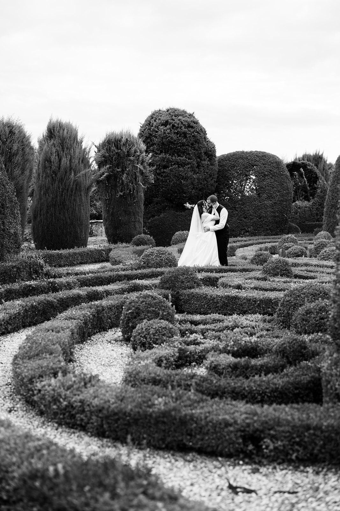
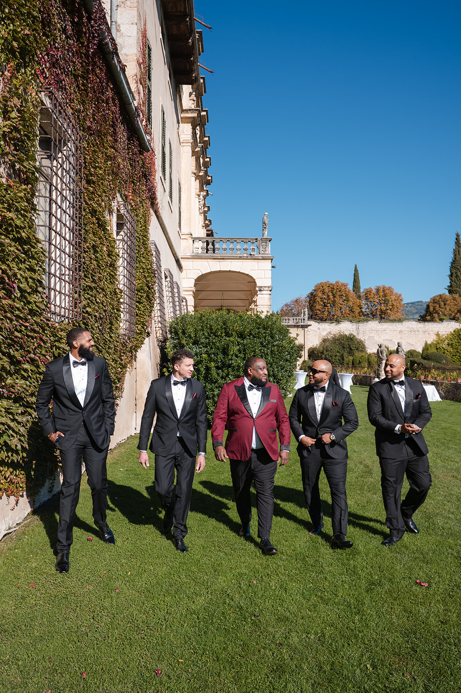
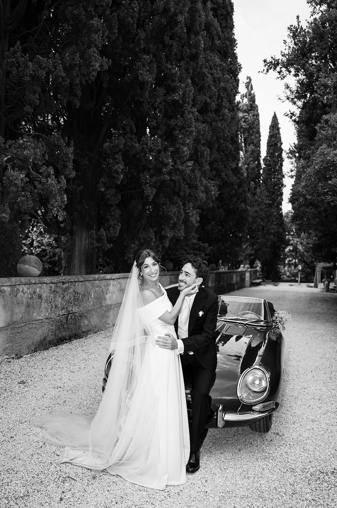

<!--
Bozza da rivedere con il proprietario.
- FOTO: segnaposto dal portfolio, non scattate in Valpolicella. Sostituirle con foto vere della zona appena disponibili, e non scrivere nelle didascalie dove sono state fatte se non è vero.
- LOCATION: informazioni generali, raccolte da fonti pubbliche (siti delle location e portali di settore, novembre 2026). Prima del lancio verificare con ogni location che ospiti ancora matrimoni.
- Villa Arvedi è in Valpantena, non in Valpolicella: citata come zona vicina, dove abbiamo davvero lavorato (film di Imani e John).
-->

La Valpolicella comincia dove finisce Verona. Bastano venti minuti per passare dalla città alle colline: vigneti a terrazze, muretti a secco che qui chiamano *marogne*, ciliegi, pievi romaniche e ville venete affacciate sulla pianura.

È la terra dell’Amarone, e si sente: sposarsi qui vuol dire una festa che sa di vino, di pietra e di campagna, con l’eleganza delle dimore storiche e la città a un passo.

## Perché la Valpolicella

Per chi cerca una villa storica senza rinunciare alla comodità, è difficile trovare di meglio. Verona, l’aeroporto e il Lago di Garda sono vicini, le location sono spesso circondate dai vigneti, e molte ville hanno una cantina dove accogliere gli ospiti per un aperitivo o una degustazione.

È anche un territorio raccolto: Negrar, Fumane, Marano, Sant’Ambrogio e San Pietro in Cariano sono a pochi chilometri l’uno dall’altro, e la giornata scorre senza lunghi spostamenti.

## La luce e le stagioni

In primavera le colline sono verdi e i ciliegi in fiore; a giugno le giornate sono lunghe e la luce della sera scivola dorata sui filari. Settembre e ottobre sono i mesi della vendemmia: i colori si scaldano, l’aria è fresca e i vigneti sono al loro momento più bello.

Per i ritratti la luce migliore arriva nell’ultima ora del giorno, quando il sole si abbassa sulla pianura e illumina le colline di traverso. In autunno arriva presto: conviene anticipare la timeline.

> Tra i filari la luce del tramonto arriva di traverso, e ogni cosa prende un colore caldo, quasi di vino.

## Location da conoscere

**Villa della Torre, Fumane.** Una villa rinascimentale del Cinquecento, con il cortile a peristilio e i celebri camini a forma di mascherone. Oggi appartiene a una storica famiglia di produttori, e unisce arte, giardini e vino.

**Villa Mosconi Bertani, Arbizzano di Negrar.** Una villa settecentesca con un parco romantico e un laghetto, legata a una delle cantine storiche della Valpolicella.

**Villa Rizzardi, Negrar.** Famosa per il suo giardino settecentesco, con viali di carpini, scorci prospettici e un teatro di verzura.

**Villa Spinosa, Negrar.** Una villa dell’Ottocento in collina, nel piccolo borgo di Jago, tra giardini e vigneti.

**Villa Amistà, San Pietro in Cariano.** Una villa veneta del Cinquecento, oggi hotel, dove l’architettura storica incontra l’arte contemporanea.

**La Pieve di San Giorgio di Valpolicella.** Una pieve romanica in cima alla collina, nel borgo di San Giorgio: per una cerimonia religiosa con una vista che abbraccia la valle.

Poco più a est, in Valpantena, c’è **Villa Arvedi**, dove abbiamo raccontato il matrimonio di Imani e John ([guardate il loro film](/it/#films)): un altro modo di vivere le colline veronesi, tra cipressi e giardini all’italiana.

Disponibilità, capienza e regole per la cerimonia cambiano da location a location: verificatele sempre direttamente con la struttura o con il vostro wedding planner.

## Consigli pratici

**Le strade di collina.** Sono strette e a volte senza illuminazione: per gli ospiti una navetta tra cerimonia, ricevimento e hotel è quasi sempre la scelta migliore.

**Gli ospiti da lontano.** L’aeroporto di Verona è a circa mezz’ora; molti ospiti possono dormire in città o nei relais della zona.

**La cantina.** Se la location ne ha una, sfruttatela: un aperitivo tra le botti o una degustazione per gli ospiti stranieri sono momenti che restano, anche nelle foto.

**Le sere d’autunno.** In ottobre la temperatura scende in fretta dopo il tramonto: prevedete uno spazio coperto o riscaldato per la cena.

## Come lo raccontiamo noi

La Valpolicella per noi è casa: siamo a Verona, a pochi minuti dalle sue colline. Fotografia e cinema insieme, con un’unica visione: raccontare la vostra giornata senza forzarla, tra la pietra delle ville, il verde dei vigneti e la luce della sera. Per farvi un’idea del nostro sguardo, guardate i nostri [wedding film](/it/#films), sfogliate il [portfolio](/it/#portfolio) e leggete i diari dei nostri [Real Weddings](/it/#real-weddings).

Lavoriamo in contatto diretto con il vostro wedding planner e con la location, per costruire una timeline che segua la luce e lasci a voi solo il piacere di viverla.
