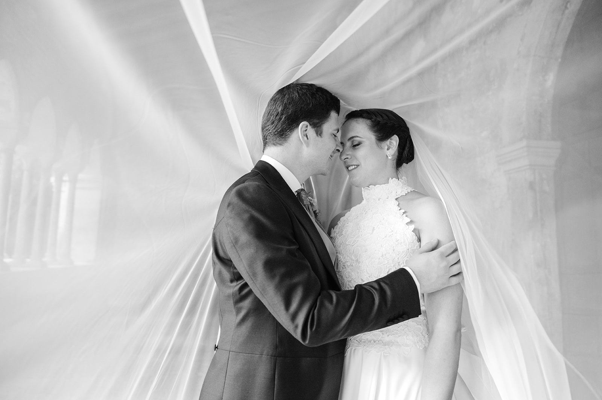
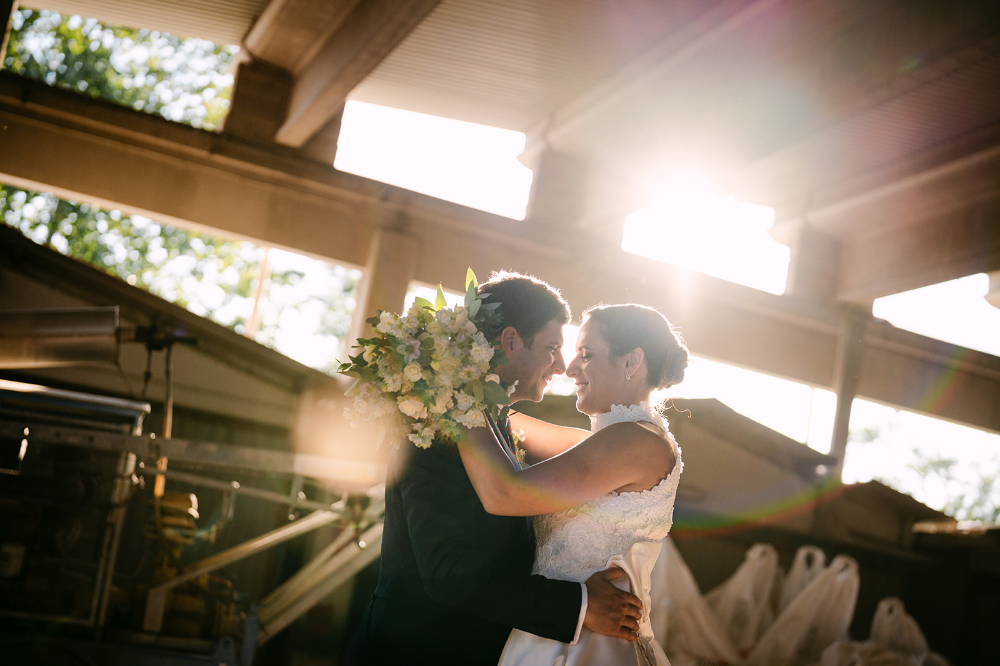
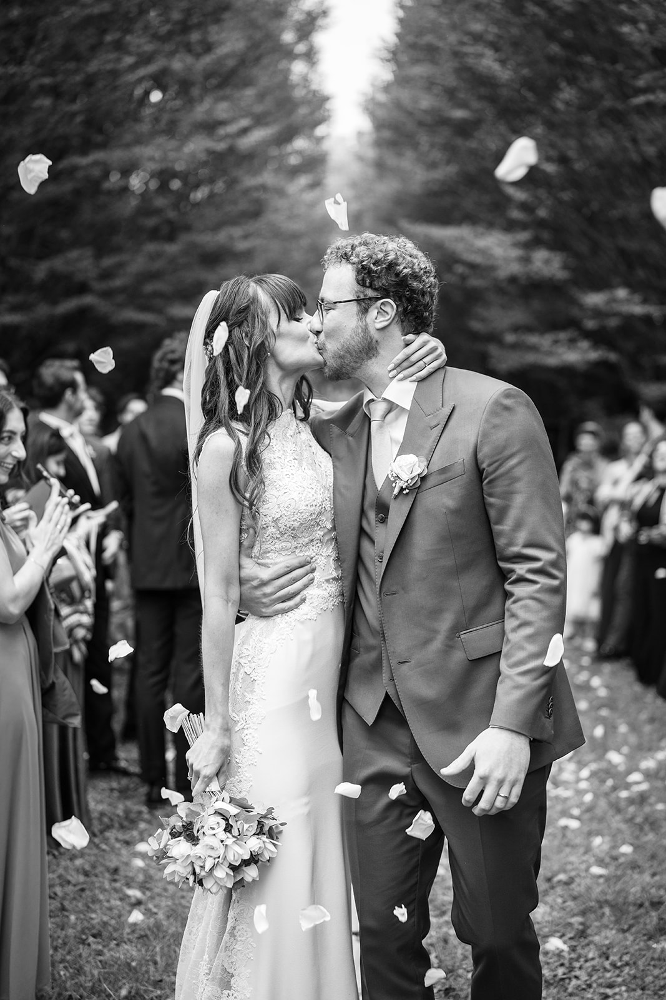
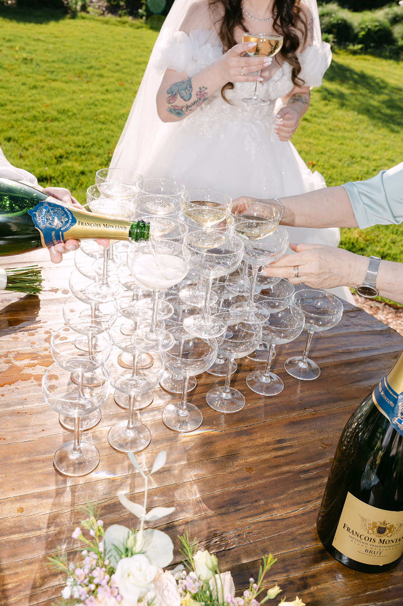

<!--
Bozza da rivedere con il proprietario.
- FOTO: segnaposto dal portfolio, non scattate a Venezia. Il proprietario forse ha foto di un elopement a Venezia: se sì, usarle qui.
- CERIMONIE CIVILI: informazioni da fonti pubbliche (novembre 2026). Sedi, tariffe e documenti vanno verificati con il Comune di Venezia prima del lancio.
-->

Venezia non assomiglia a nessun altro posto. Non ci sono auto, solo acqua, ponti e calli; ci si sposta in barca o a piedi, e ogni tragitto è già un pezzo di racconto. Per un matrimonio è una scelta coraggiosa e indimenticabile.

È la città perfetta per un matrimonio intimo, con pochi ospiti, o per una fuga d’amore a due: un *elopement*, come si dice oggi. Ma con la giusta organizzazione può ospitare anche feste più grandi, nei palazzi sull’acqua o sulle isole della laguna.

## Il matrimonio civile

Il Comune di Venezia celebra i matrimoni civili a **Palazzo Cavalli**, un palazzo storico affacciato sul Canal Grande, e in alcune altre sedi storiche della città. Si arriva in barca, e si esce sposati sul canale: difficile immaginare un inizio più veneziano.

Per una cerimonia simbolica le possibilità si moltiplicano: terrazze e giardini degli hotel sul Canal Grande, chiostri nascosti, le isole della laguna. Sedi, tariffe e documenti cambiano: verificateli sempre con il Comune o con il vostro wedding planner.

## Un matrimonio intimo, o una fuga a due

Venezia dà il meglio quando la si vive senza fretta. Una passeggiata all’alba in una Piazza San Marco quasi vuota, un giro in gondola tra i canali, la luce sulle facciate del Canal Grande.

Fuori dal centro, la laguna ha un’altra anima: **Burano** con le sue case colorate, **Torcello** silenziosa e verde, con la sua basilica antica, e la vista su San Marco dall’isola di **San Giorgio Maggiore**. Per un elopement sono luoghi perfetti: pochi passi, nessuna folla, tanta luce.

> A Venezia ogni tragitto è un racconto: si parte in barca, si arriva sposati.

## La luce e le stagioni

Primavera e settembre sono i mesi migliori: luce morbida, temperature piacevoli e una città meno affollata che in piena estate. L’inverno ha il suo fascino, con la nebbia sulla laguna, ma in autunno e in inverno può arrivare l’acqua alta.

Per le foto il momento più prezioso è l’alba: la città è ancora vuota, l’acqua è ferma e la luce si posa piano sulle facciate. La sera, invece, il tramonto colora la laguna di rosa e d’oro.

## Consigli pratici

**Tutto in barca.** Taxi acquei, barche private e facchini per i bagagli vanno prenotati con anticipo; in un matrimonio veneziano la logistica è metà della festa.

**Le scarpe.** Ponti, gradini e masegni: per sposi e ospiti meglio scarpe comode, almeno per gli spostamenti.

**Le regole della città.** In alcune giornate chi arriva solo in giornata paga un contributo di accesso, e ci sono regole precise per foto e riprese con droni o attrezzatura ingombrante: informatevi per tempo.

**Gli ospiti da lontano.** L’aeroporto Marco Polo è collegato alla città anche via acqua; da Verona si arriva in treno in poco più di un’ora.

## Come lo raccontiamo noi

Siamo a Verona, a poco più di un’ora di treno da Venezia. Fotografia e cinema insieme, con un’unica visione: raccontare la vostra giornata senza forzarla, seguendo il ritmo lento della città e della sua luce. Per farvi un’idea del nostro sguardo, guardate i nostri [wedding film](/it/#films), sfogliate il [portfolio](/it/#portfolio) e leggete i diari dei nostri [Real Weddings](/it/#real-weddings).

Lavoriamo in contatto diretto con il vostro wedding planner, per costruire una giornata in cui ogni barca, ogni ponte e ogni ritratto arrivino al momento giusto.
