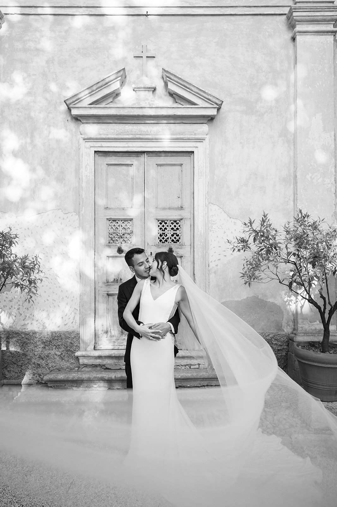
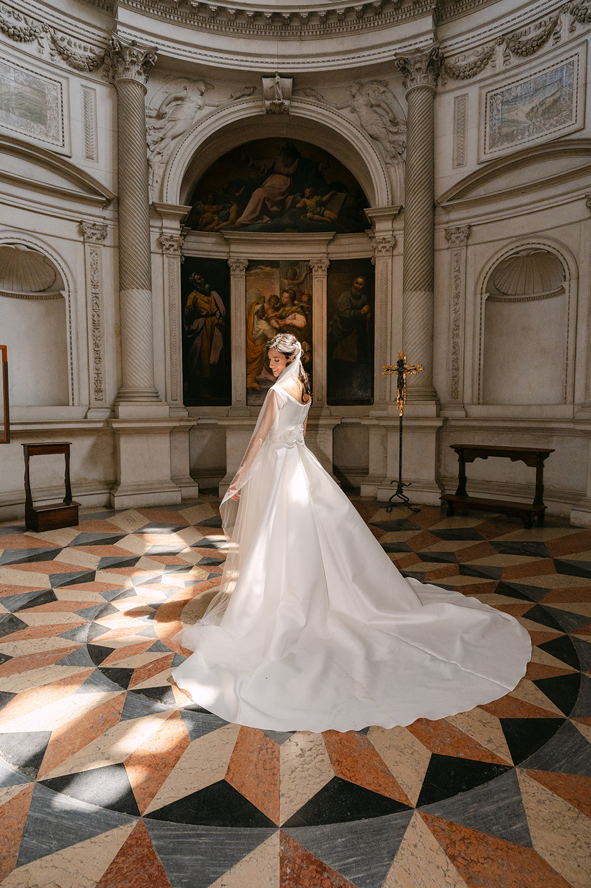
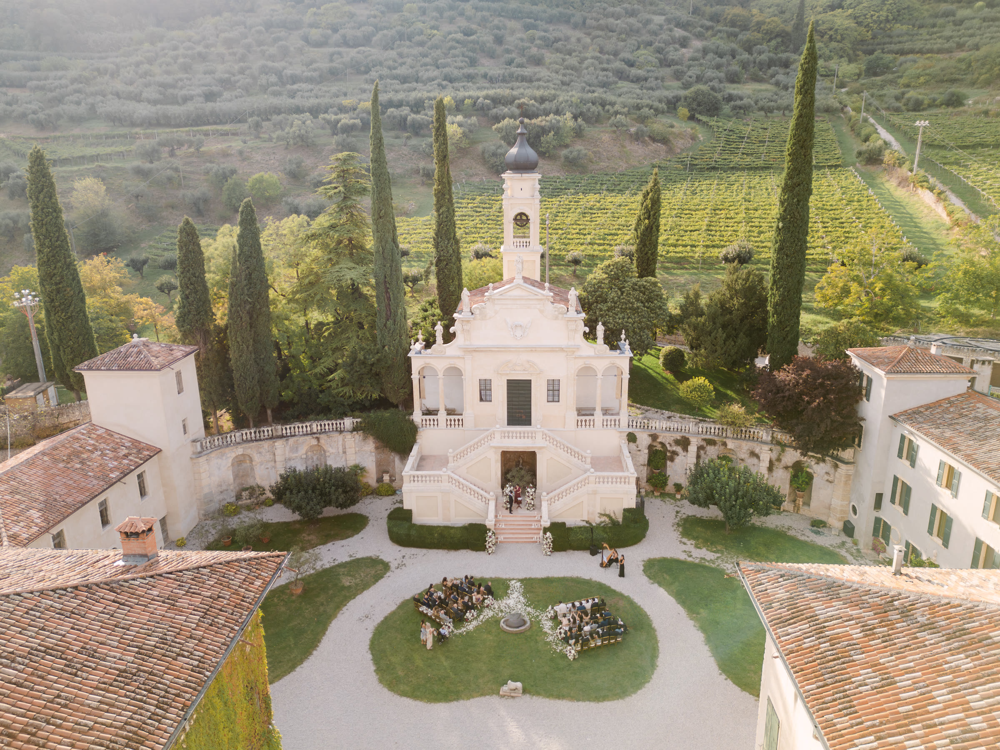
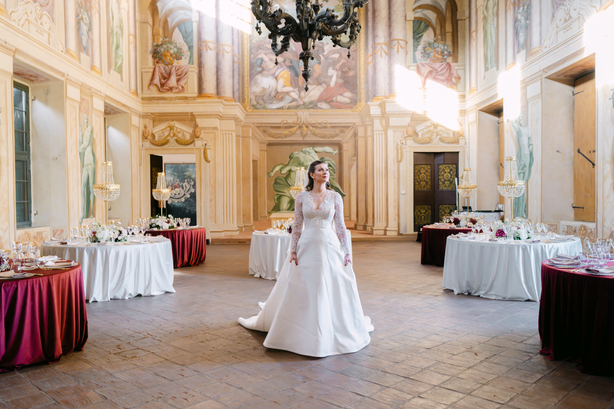
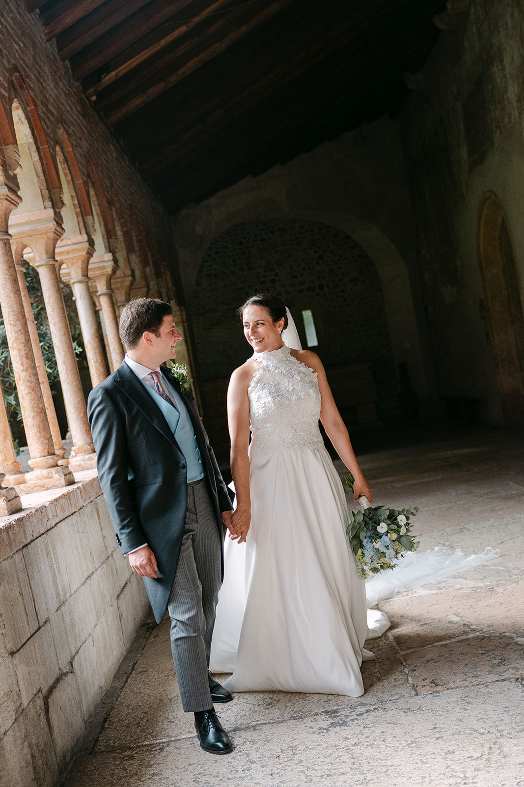
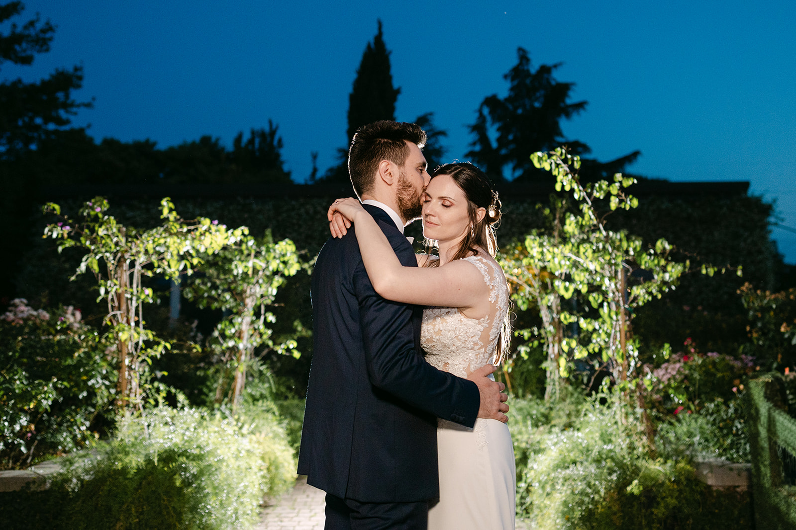

<!--
Bozza da rivedere con il proprietario.
- FOTO: segnaposto dal portfolio. Sostituirle con foto vere di Verona e non scrivere nelle didascalie dove sono state fatte se non è vero.
- CERIMONIE CIVILI: informazioni dal Comune di Verona e da blog di settore (novembre 2026). Sale, tariffe e requisiti cambiano: verificare sul sito del Comune prima del lancio.
- Relais Fra Lorenzo e Villa Arvedi: location dove abbiamo lavorato davvero (film di Daniel e Josiane, Imani e John, Jasmine e Daniel; diario di Alina e Omrane, con le sue foto vere di Villa Arvedi).
- Villa La Favorita (diario di Giada e Luca) non è citata: secondo le fonti si trova nel mantovano, da confermare.
-->

Verona è casa nostra. Per il mondo è la città di Romeo e Giulietta, e per chi si sposa qui quella storia è un filo che si sente ovunque. Ma Verona è anche l’Arena, l’Adige che la attraversa in un’ansa larga, i palazzi di pietra rosa e le colline che la abbracciano a nord.

È una città da vivere a piedi, dove in pochi passi si passa da una piazza medievale a un ponte romano. Per un matrimonio vuol dire una cosa sola: ogni angolo può diventare un ritratto.

## Una città da attraversare a piedi

Il centro storico è patrimonio UNESCO, ed è raccolto: Piazza delle Erbe con i suoi palazzi affrescati, Piazza dei Signori, l’Arena, Ponte Pietra sull’Adige. Dall’altra parte del fiume, la scalinata di Castel San Pietro porta al belvedere da cui si vede tutta la città, ed è uno dei posti più belli per i ritratti al tramonto.

## Le cerimonie civili nei luoghi di Giulietta

Il Comune di Verona celebra i matrimoni civili in alcuni luoghi storici della città: la Casa di Giulietta, la sala affrescata del Museo degli Affreschi accanto alla Tomba di Giulietta, la Sala Arazzi di Palazzo Barbieri, a due passi dall’Arena, e la Cappella dei Notai.

Sono cerimonie raccolte, per pochi ospiti, spesso seguite da un ricevimento in una villa sulle colline. Sale disponibili, tariffe e documenti cambiano nel tempo e a seconda della nazionalità degli sposi: verificateli sempre con il Comune o con il vostro wedding planner.

> A Verona basta girare un angolo per trovare una luce nuova: tra le pietre del centro, ogni vicolo può diventare un ritratto.

## La luce e le stagioni

Primavera e settembre sono i momenti più belli: aria tiepida, luce morbida e una città vivace ma non affollata. In estate fa caldo e, durante la stagione lirica dell’Arena, il centro è pieno di visitatori.

Per i ritratti in centro il segreto è l’alba: piazze vuote, pietra che si accende di rosa, il fiume ancora fermo. La sera, invece, conviene salire a Castel San Pietro e guardare il sole calare sui tetti.

## Le location intorno alla città

**Relais Fra Lorenzo.** Una villa sulla collina sopra il centro storico, con una terrazza panoramica sulla città. Prende il nome dal frate che, nella storia, sposò in segreto Romeo e Giulietta. Qui abbiamo raccontato il matrimonio di Daniel e Josiane: [guardate il loro film](/it/#films).

**Villa Arvedi.** Una villa barocca sulle colline della Valpantena, a pochi minuti dalla città, tra cipressi e giardini all’italiana, con la Sala dei Titani affrescata per le cene più scenografiche. Qui abbiamo raccontato i matrimoni di Imani e John e di Jasmine e Daniel, che trovate tra i nostri [wedding film](/it/#films), e quello di Alina e Omrane: [leggete il loro diario](/it/real-weddings/alina-omrane/).

Per chi cerca vigneti e ville venete c’è la [Valpolicella](/it/guide/valpolicella/), a venti minuti; per l’acqua e i tramonti, il [Lago di Garda](/it/guide/lago-di-garda/), a mezz’ora.

## Consigli pratici

**La ZTL.** Il centro è una zona a traffico limitato: per auto d’epoca, navette e fornitori servono permessi da chiedere per tempo.

**Gli hotel.** Nei mesi della stagione lirica le camere in centro finiscono presto: prenotate con anticipo per gli ospiti.

**Gli ospiti da lontano.** L’aeroporto di Verona è a un quarto d’ora dal centro, e la stazione di Porta Nuova collega la città a Milano, Venezia e Bologna.

**Dalla cerimonia alla festa.** Se vi sposate in centro e festeggiate in collina, calcolate il tragitto con calma e lasciate tempo per i ritratti lungo la strada.

## Come lo raccontiamo noi

Verona la conosciamo come si conosce casa: le ore in cui le piazze si svuotano, gli angoli dove la luce arriva per prima, le strade per non perdere tempo tra cerimonia e festa. Fotografia e cinema insieme, con un’unica visione: raccontare la vostra giornata senza forzarla. Per farvi un’idea del nostro sguardo, guardate i nostri [wedding film](/it/#films), sfogliate il [portfolio](/it/#portfolio) e leggete i diari dei nostri [Real Weddings](/it/#real-weddings).

Lavoriamo in contatto diretto con il vostro wedding planner e con la location, per costruire una timeline che segua la luce e lasci a voi solo il piacere di viverla.
